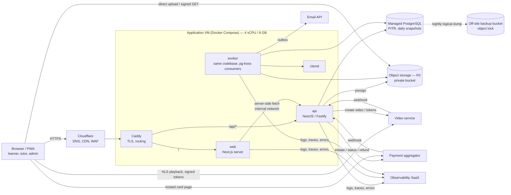

# 04 — Target Architecture Specification

> **Revision 3 (2026-10-11):** §17 now has an exhaustive privileged-client allowlist, SECURITY DEFINER resolvers for webhooks, video-webhook routing, the payment capability model and provider approval gate, console session lifetimes, tenant languages, course and material settings, and single-tenant restore (§17.16).
>
> **Revision 2 (2026-10-11): multi-tenancy.** The platform must host many isolated tenants with their own branding, settings, content and features (03 §9). **§17 is the authoritative tenancy design.** The sections below were updated where tenancy changes them: drivers, same-origin note, module table, rendering, sessions. Where an older sentence assumes a single site, §17 governs.

## 1. Architectural drivers

| Driver | Evidence | Architectural consequence |
|---|---|---|
| Solo or small team, AI-assisted implementation | ASSUMED from repo history and prior projects (02 §2) | Few moving parts; conventional, strongly typed frameworks; one language end-to-end |
| Money changes hands | CONFIRMED (A3) | ACID database, idempotency, an append-only ledger, server-verified payments, full audit |
| Assessment integrity | CONFIRMED (A2: quizzes) | Server-authoritative attempt engine; snapshots; DB-level uniqueness |
| Mobile-first users on costly, variable data | ASSUMED (market) | Server-rendered public pages, small bundles, CDN, PWA, data-saver, resumable uploads |
| Heavy media (video, PDFs) | CONFIRMED (A2: materials) | Media bypasses the API: object storage + managed video + signed URLs |
| SEO for a course catalogue (revenue depends on discovery) | PROPOSED | Server rendering or ISR for catalogue, course and tutor pages |
| Low budget, uncertain scale | A4 "recommend" | Single VM + managed DB at launch; documented scale-out path driven by metrics |
| Future native apps possible | 03 §6 | Versioned REST API with OpenAPI, usable by any client; no business logic in the web tier |
| Many independent tenants with their own branding, settings, content and features | Client-stated (second brief, B1) | Tenant-aware everything: host-based tenant resolution, tenant id on every tenant-owned row, runtime theming, per-tenant settings, features and payment accounts (§17) |
| Strict tenant isolation; platform vs tenant administration | Client-stated (B2, B3) | Defence in depth: app-layer scoping **plus** PostgreSQL row-level security, composite tenant foreign keys, host-only sessions, a separate platform realm, audited break-glass support access (§17) |

## 2. Architectural style: modular monolith (ADR-001)

| Option | Fit | Verdict |
|---|---|---|
| **Modular monolith** (one API deployable + one worker process from the same codebase, strict internal module boundaries) | One team, one database, transactions span modules (payment → enrolment → ledger must be atomic), simplest ops | **Chosen** |
| Microservices | Distributed transactions for payment → enrolment, many deployables, network failure modes; no team-scaling need | Rejected |
| Full-stack Next.js only (DB access from server actions and route handlers) | Fewest deployables, but weak module boundaries, webhook and worker logic awkward in a web framework, and harder to serve future mobile apps | Rejected as primary; viable fallback if the client insists on one deployable |
| Backend-as-a-service (Supabase or Firebase + edge functions) | Fast start, but payments, ledger and quiz integrity rules end up spread across RLS policies and functions; vendor lock-in | Rejected |

The **exit path** stays open: every module owns its tables and exposes a public service interface, so one module (e.g. `media` or `assessment`) could become a separate service later without a rewrite.

## 3. Technology stack

Pin exact versions at project start (current stable majors as of October 2026). Versions below are minimum majors.

| Layer | Choice | Why | Trade-offs | Alternative |
|---|---|---|---|---|
| Language | **TypeScript (strict)** everywhere | One language; team experience; shared contracts | — | — |
| Runtime | **Node.js 24 LTS** | Long support window; team knows it | CPU-heavy work goes to the worker | Bun (less proven in production) |
| API framework | **NestJS 11 on the Fastify adapter** | Modules map to domain modules; **guards** make authorization declarative; interceptors for audit and logging; OpenAPI generation; very common, so AI-generated code stays consistent | Decorators and DI ceremony | Fastify + hand-rolled module structure |
| Contracts and validation | **Zod 4** schemas in `packages/contracts`; API validates with them; OpenAPI generated from them; web forms reuse them | One source of truth; no drift between front and back | Zod→OpenAPI edge cases | class-validator (no sharing with web) |
| Database | **PostgreSQL 17+** (managed, with PITR) | Transactional DDL; partial unique indexes; CHECK and exclusion constraints; JSONB for snapshots; `tsvector` + `pg_trgm` search; job queue support | One more thing to learn vs MySQL | MySQL 8.4 (rules move into app code; weaker search) |
| ORM and migrations | **Prisma** (current major) + SQL migrations committed; `$queryRaw`/TypedSQL for reports | Team knows it; readable schema; deterministic migrations | Partial indexes and CHECK constraints are written as raw SQL inside migrations | Drizzle ORM; Kysely |
| Background jobs | **pg-boss** (Postgres-backed queue) | No Redis at launch; jobs enqueued **in the same transaction** as business writes (transactional outbox); retries, cron, dead-letter | Lower throughput than Redis queues, still far above need | BullMQ + Valkey when needed |
| Web framework | **Next.js (App Router) + React 19** | Server-rendered or ISR public pages (SEO, fast first paint on slow networks); client components for the logged-in app; one web deployable | Two rendering modes to understand; Node server required | React Router 7 (framework mode); Vite SPA + prerender if SEO is dropped (Q-PRD-5) |
| Server state (web) | **TanStack Query 5** | Caching, retries, polling (payment status), optimistic updates | — | SWR |
| Forms | **React Hook Form + Zod resolver** | Same schemas as the API | — | Conform |
| UI primitives | **Radix UI primitives**, own component library in `packages/ui` | Accessible behaviour (focus, ARIA, keyboard) without a visual style; lets Copperline look like its own product | Must build visuals ourselves | MUI (heavier; generic Material look) |
| Styling | **Tailwind CSS 4** driven by **CSS-variable design tokens** | Tokens → utilities; tiny CSS output; theme switching through variables | Class-heavy markup (handled by components) | CSS Modules + vanilla-extract |
| Rich text | **Tiptap** (ProseMirror) editor; content stored as JSON; rendered server-side to sanitised HTML | Team has used it; structured, safe content | Custom nodes (maths, callouts) need care | Lexical |
| Maths | **KaTeX** | Fast, server-renderable | — | MathJax (heavier) |
| PDF viewing | **pdf.js** in a lazy-loaded viewer | Consistent on Android | Large, so lazy-loaded | Native viewer |
| Object storage | **S3-compatible**; **Cloudflare R2** recommended | Zero egress fees (downloads are the main cost); S3 API, so swappable | Vendor account | Backblaze B2 + CDN; AWS S3 |
| Video | **Managed streaming service behind a `VideoProvider` port**; Bunny Stream recommended at this budget | Transcoding, adaptive HLS (low bitrates for data saving), token-authenticated playback, resumable direct upload; far cheaper and simpler than self-hosting | Per-GB delivery cost; vendor dependency (port keeps it swappable) | Cloudflare Stream, Mux (higher cost, excellent DX) |
| Payments | **Regional aggregator behind a `PaymentProvider` port** (must support MTN MoMo, Airtel Money, Zamtel and Visa/Mastercard in ZMW, plus webhooks, status query and refund APIs) | One integration covers mobile money and card; hosted card page keeps PCI scope to SAQ-A | Fees; onboarding lead time | Direct mobile-network APIs (several integrations, more KYC). **Provider choice: Q-PAY-1** |
| Email | Transactional email API (Postmark, Resend or Amazon SES) behind a `Mailer` port; React Email templates | Deliverability, bounce webhooks | Monthly cost | SMTP relay |
| Malware scanning | **ClamAV** (clamd container) called by the worker | Free, standard | ~1–1.5 GB RAM | Provider scanning service |
| Reverse proxy / TLS | **Caddy** | Automatic HTTPS, simple config, HTTP/3 | — | Nginx + certbot |
| CDN / DNS / WAF | **Cloudflare** (free or Pro) | Edge caching of static assets and images; DDoS protection; basic WAF rules | — | Bunny CDN |
| Observability | **pino** JSON logs; **OpenTelemetry** traces; **Sentry** (or self-hosted GlitchTip) for errors (web + API); uptime checks; a hosted log and metrics backend (Grafana Cloud free tier or Better Stack) | Cheap, standard, vendor-neutral instrumentation | Another account to manage | Self-host Loki/Prometheus (more ops) |
| Testing | **Vitest** (unit), **Testcontainers** (Postgres integration), **Supertest/light-my-request** (API), **Playwright** (e2e + axe accessibility), **k6** (load) | Covers the pyramid in 07 | — | Jest |
| Monorepo | **pnpm workspaces + Turborepo** | Shared contracts and UI packages; cached builds | — | Nx |

## 4. Deployment architecture (launch)



- **Same origin per tenant host:** each tenant site `https://{slug}.<platform-domain>` serves both the web and the API (`/api/v1/...` goes to the api container) on the **same host**. The console has its own host. This removes CORS and makes host-only `SameSite=Lax` cookies sufficient for CSRF defence (with an Origin check as a second layer). Caddy accepts the wildcard subdomain with a wildcard certificate (DNS-01 challenge). Custom domains are LATER (§17.3).
- **Region:** choose by measured latency from target-country mobile networks. Candidates: South Africa (lowest latency to Zambia) versus Western Europe (cheaper, more providers). Run a 1-week latency test from Airtel and MTN connections before committing (Q-OPS-2). Static and media delivery reach users through edge networks either way.
- **Launch cost estimate (ASSUMED, verify quotes):** VM US$25–50, managed Postgres (2 GB, PITR) US$15–60, R2 storage US$1–10 (no egress fees), email US$0–15, error tracking and logs US$0–30, domain and Cloudflare US$0–25. Total ≈ **US$60–150/month**, plus **video delivery**, which scales with minutes watched (Q-CNT-1).
- **Scale-out path (only when metrics require it):** (1) resize the VM; (2) two app VMs behind a load balancer, with sessions already in Postgres and the rate-limit store moved to Postgres or Valkey; (3) a Postgres read replica for reports and catalogue; (4) Valkey + BullMQ if job throughput saturates pg-boss; (5) Meilisearch if catalogue search outgrows `pg_trgm`. Triggers are listed in §13.

## 5. Repository and module structure

```
studyhub/
  apps/
    web/                    Next.js: routes per space (public, learn, studio, admin)
    api/                    NestJS: src/main.ts (HTTP), src/worker.ts (jobs)
  packages/
    contracts/              Zod schemas, error codes, enums, generated OpenAPI + typed client
    ui/                     Copperline tokens + components (+ Storybook)
    config/                 tsconfig, eslint, prettier presets
  infra/
    compose/                docker-compose.{dev,prod}.yml, Caddyfile
    scripts/                backup, restore, seed, smoke tests
  docs/
    blueprint/              these documents
    adr/                    architecture decision records
    runbooks/               deploy, rollback, restore, payment incident, key rotation
```

### 5.1 API modules and ownership

| Module | Owns (tables) | Responsibilities | Depends on (public interfaces only) |
|---|---|---|---|
| `platform` (shared kernel) | pg-boss schema, `outbox` | config, DB client, transactions, clock, ids, logging, storage port, mailer port, event bus, rate limiting | — |
| `identity` | `user`, `credential`, `session`, `one_time_token`, `role_assignment` | registration, verification, sign-in, sessions, password reset, roles, policy evaluation helpers | platform |
| `profiles` | `tutor_profile`, `payout_method`, `notification_preference` | account settings, tutor application, public tutor profile | identity, media |
| `catalog` | `category`, `subject`, `course`, `section`, `lesson`, `lesson_attachment`, `course_submission` | authoring, outline, publish workflow, public catalogue and search | identity, media, assessment (validation), settings |
| `media` | `asset` (an upload slot is an asset in `PENDING_UPLOAD`) | upload slots, scanning, signed URLs, video provider integration | platform |
| `learning` | `enrollment` (incl. `progress_percent`), `lesson_progress` | entitlements, player data, progress, completion | catalog, identity |
| `assessment` | `question`, `question_option`, `quiz`, `quiz_item`, `quiz_draw_rule`, `attempt`, `attempt_item`, `attempt_answer` | question bank, quizzes, attempts, grading, practice, analytics | learning (entitlement check), catalog |
| `commerce` | `order`, `order_item`, `payment`, `payment_event`, `refund`, `receipt`, `receipt_sequence`, `idempotency_key` | checkout, payment provider port, webhooks, reconciliation, receipts, refunds | learning (grant/revoke in tx), ledger (in tx), catalog |
| `ledger` | `ledger_entry`, `payout` | earnings, balances, payouts, reconciliation check | commerce (read), settings |
| `notifications` | `notification`, `notification_preference` | in-app notifications, email templates, preferences | profiles |
| `admin` | — (read models, queues) | **tenant** admin: queues, dashboards, exports | all (read-only interfaces) |
| `audit` | `audit_log` (tenant), `platform_audit_log` | append-only audit writes, viewers | platform |
| `settings` | `platform_setting` (global), `tenant_setting` | typed global and per-tenant settings with audit | audit, tenancy |
| `tenancy` (revision 2) | `tenant`, `tenant_domain`, `tenant_branding`, `tenant_feature`, `plan`, `tenant_usage_daily`, `invitation` | tenant resolution from host, tenant context, lifecycle, branding and theme compilation, feature entitlement evaluation, limits and quotas, usage metering | platform, media, audit |
| `console` (revision 2) | `platform_user`, `platform_credential`, `platform_session`, `support_access_grant` | platform realm auth, tenant management, plans, staff, support access, global settings; one of the three entry points on the privileged-client allowlist (§17.4) | tenancy, audit, settings |
| `payments-accounts` (part of `commerce`) | `payment_account` | per-tenant provider credentials (encrypted), connection tests, webhook secret resolution | commerce, tenancy |

### 5.2 Layering inside a module

```
modules/commerce/
  api/            controllers (HTTP), webhook controller; map contracts <-> application calls
  application/    use cases: CreateOrder, StartPayment, ConfirmPayment, IssueRefund (transactions live here)
  domain/         pure TypeScript: order and payment state machines, money arithmetic, fee calc (no framework imports)
  infra/          Prisma repositories, PaymentProvider adapters (aggregator, fake), job handlers
  commerce.module.ts
  index.ts        the ONLY export surface for other modules
```

Rules (enforced in CI with `dependency-cruiser`):
1. Controllers contain no business logic: validate, authorize, call one use case, map the response.
2. Domain code imports nothing from NestJS, Prisma or the network.
3. A module never queries another module's tables. It calls the other module's `index.ts` service. Calls that must be atomic pass a transaction context (`tx`) explicitly.
4. Cross-module side effects that can be asynchronous (emails, notifications, analytics, cache revalidation) go through the **outbox**: a row written in the same transaction, then dispatched by pg-boss.
5. Providers (payment, video, mail, storage, scanner) are **ports** with a production adapter and a **fake adapter** used in tests and local development.

## 6. Frontend architecture

| Concern | Approach |
|---|---|
| Spaces | Route groups: `(public)` (SSR/ISR: home, catalogue, course, tutor, legal), `(auth)`, `learn/*`, `studio/*` (tutor), `admin/*`. Each space has its own layout, navigation and code-split bundle. Learners never download Studio or Admin code. |
| Rendering | Public pages: server components, ISR (revalidate 300 s plus on-demand revalidation by tag when a course is published or changed). Logged-in spaces: a server-rendered shell + client components fetching through TanStack Query. **No database access from Next.js**; it is a pure presentation tier calling the API. **Tenancy:** Next.js middleware rewrites every request to an internal `/_t/[host]/…` segment, so ISR and fetch caches are keyed by tenant host and one tenant's cached page can never be served to another. Revalidation tags include the tenant id (`t:{tenantId}:course:{id}`). |
| Data access | A typed API client generated from `packages/contracts` (OpenAPI → TypeScript); one `apiFetch` wrapper that handles problem+json errors, 401 → sign-in redirect, and request ids. Query keys are a single factory per module. |
| State | Server state only in TanStack Query. URL state for filters, tabs and pagination. Local UI state in components. Quiz runner: a small reducer + IndexedDB queue for unsent answers. No global store. |
| Forms | RHF + shared Zod schemas; server errors mapped onto fields via `errors[].field` in the problem response. |
| Components | `packages/ui`: primitives (Button, Input, Select, Dialog, Sheet, Tabs, Toast, Table, Tooltip, etc.) and patterns (EmptyState, ErrorState, PermissionDenied, PageHeader, FilterBar, QueueList, Stepper). Feature components live with their route. Business rules stay in the API; the UI never computes prices, scores or permissions (it only reflects `allowedActions` returned by the API). |
| Permissions in UI | Resource responses include `allowedActions` (e.g. `["edit","publish","delete"]`) computed by the server's policy layer, so the UI never re-implements authorization. |
| PWA | Service worker (Serwist): precache the shell and fonts; runtime cache for catalogue images; offline fallback page; caching of downloadable lesson files (SHOULD). No caching of authenticated API JSON except quiz queue replay. |
| Performance | Route-level code splitting; next/image with AVIF/WebP via the CDN; self-hosted subset fonts (2 families, ≤4 files); lazy-load pdf.js, Tiptap editor, video player and charts; budgets enforced in CI (Lighthouse CI). |
| i18n | `next-intl` message catalogs from day one; `Intl.NumberFormat('en-ZM', { currency: 'ZMW' })`; dates in user time zone. |
| Testing | Component tests (Vitest + Testing Library), Storybook visual review, Playwright e2e + axe. |

## 7. Key data flows

### 7.1 Purchase with mobile money (and card variant)

```mermaid
sequenceDiagram
  autonumber
  participant B as Browser
  participant A as API (commerce)
  participant P as Payment aggregator
  participant W as Worker
  participant DB as PostgreSQL
  B->>A: POST /orders {courseId} (Idempotency-Key)
  A->>DB: tx: check BR-07, reuse pending order (BR-35) or insert order(PENDING) with price snapshot
  A-->>B: 201 order
  B->>A: POST /orders/{id}/payments {method: MOBILE_MONEY, msisdn}
  A->>DB: insert payment(INITIATED, providerRef = our UUID)
  A->>P: charge request (amount, ZMW, msisdn, reference, callback URL)
  P-->>A: accepted (provider tx id)
  A->>DB: payment -> PENDING
  A-->>B: 202 {paymentId, status: PENDING, nextAction: APPROVE_ON_PHONE}
  Note over B: Card: nextAction = REDIRECT {url} to hosted page instead
  loop every 3 s, backoff to 10 s, max 5 min
    B->>A: GET /orders/{id}
  end
  P->>A: webhook (signed)
  A->>A: verify signature
  A->>DB: insert payment_event (unique provider_event_id) ON CONFLICT DO NOTHING; enqueue process job
  A-->>P: 200
  W->>P: GET transaction status (authoritative)
  W->>DB: tx: lock payment FOR UPDATE; if already SUCCEEDED -> stop (idempotent)
  W->>DB: same tx: payment SUCCEEDED; order PAID; enrollment ACTIVE (learning.grant); ledger entries; receipt number; outbox(receipt email, notifications)
  B->>A: GET /orders/{id}
  A-->>B: PAID -> "Start learning"
  Note over W,P: Reconciliation cron: every 1 min, query PENDING payments older than 2 min (backoff up to 24 h)
```

### 7.2 Payment guarantees
- **Idempotency:** `Idempotency-Key` header on `POST /orders` and `POST /orders/{id}/payments`, stored with the request hash and response for 24 h. Same key + same body returns the stored response; same key + different body returns 422.
- **Exactly-once effects:** `payment_event(provider, provider_event_id)` is unique. Confirmation runs inside a transaction with `SELECT … FOR UPDATE` on the payment and only moves forward through the state machine (05 §3.6).
- **Never trust the client:** return URLs only trigger a status check.
- **Amount check:** authoritative amount and currency from the provider must equal the order's snapshot (BR-10).
- **Provider outage:** the "Pay" button shows a provider-down state when the circuit breaker is open (5 failures in 1 min); pending payments are reconciled later.

### 7.3 Quiz attempt

```mermaid
sequenceDiagram
  participant B as Browser (quiz runner)
  participant A as API (assessment)
  participant DB as PostgreSQL
  participant W as Worker
  B->>A: POST /quizzes/{id}/attempts
  A->>DB: tx: check enrollment, availability, attempt count; insert attempt (partial unique: one IN_PROGRESS) + attempt_items (question snapshot, shuffled); deadlineAt
  A->>DB: enqueue job auto-submit at deadlineAt (+5 s)
  A-->>B: attempt {items WITHOUT answers, deadlineAt, serverNow}
  loop each answer change (debounced 800 ms)
    B->>A: PUT /attempts/{id}/answers/{itemId} {response, clientSeq}
    A->>DB: upsert answer if now <= deadlineAt + 30 s and attempt IN_PROGRESS and clientSeq newer
  end
  B->>A: POST /attempts/{id}/submit
  A->>DB: tx: lock attempt, grade auto items, status GRADED or NEEDS_REVIEW
  A-->>B: result (respecting feedback policy)
  W->>DB: at deadline: if still IN_PROGRESS -> same submit use case (AUTO_SUBMITTED)
```

The client displays remaining time as `deadlineAt − (serverNow + elapsed since response)`, which corrects for device clock skew.

### 7.4 Upload
1. `POST /uploads {purpose, fileName, size, contentType}` → validation (type allowlist per purpose, size) → `upload` row + presigned PUT (15 min, exact content length and type) to `quarantine/` prefix.
2. Browser PUTs directly to R2 (progress bar; retry on failure).
3. `POST /uploads/{id}/complete` → enqueue `media.scan`.
4. Worker: HEAD object (size matches), read magic bytes, ClamAV scan, image re-encode (strips EXIF and neutralises malformed images), move to `assets/` → `asset READY`; on failure `REJECTED` + notification.
5. Downloads: `GET /lessons/{id}/files/{assetId}/url` → policy check → signed GET URL (5 min, `Content-Disposition` set).

Video: `POST /videos` → `VideoProvider.createUpload()` → tus upload direct to provider → provider webhook `ready` → asset `READY`. Playback: `GET /lessons/{id}/playback` → policy → signed playback token (expires in 2 h, bound to video id).

## 8. Authentication and authorization model

- **Sessions (ADR-005):** opaque 256-bit random token in cookie `__Host-sh_session` (httpOnly, Secure, SameSite=Lax, Path=/). The database stores `sha256(token)`, user, created, last seen, expires, IP and UA. Rolling idle expiry of 30 days; absolute 90 days; admin sessions: idle 12 h, absolute 7 days. **Tenancy:** the session row stores `tenant_id`. The `__Host-` prefix forbids a `Domain` attribute, so the cookie is bound to the exact tenant host, and the API rejects any session whose `tenant_id` differs from the host-resolved tenant (BR-44). Platform staff use a separate cookie (`__Host-sh_console`) on the console host, backed by the separate `platform_session` table (§17.5).
- **CSRF:** SameSite=Lax + a check that the `Origin` header equals the site origin on all non-GET requests (+ `Sec-Fetch-Site` when present). Webhooks are exempt and authenticated by signature.
- **Passwords:** Argon2id (m=19 MiB, t=2, p=1 as the OWASP minimum; tune to about 250 ms on production hardware); breached-password check; no composition rules beyond length ≥10.
- **Admin 2FA (SHOULD):** TOTP with recovery codes; required for the `ADMIN` role once enabled for the platform.
- **Policy layer:** `can(actor, action, resource)` functions per module (e.g. `coursePolicy.canEdit(actor, course)` = admin OR (tutor approved AND course.ownerId == actor.id)). Nest guards apply role checks; use cases call the policy for ownership checks after loading the resource. Responses include `allowedActions`. **404 instead of 403** for resources the actor may not know exist (other tutors' drafts, other learners' attempts).
- **Authorization matrix:** a table in `packages/contracts` of endpoint × role × ownership → expected status, driving generated API tests (07 §3).

## 9. API conventions

| Convention | Rule |
|---|---|
| Base | `/api/v1`; JSON; UTF-8; `camelCase` fields |
| Versioning | URL major version; additive changes within v1; breaking change → v2 alongside for ≥6 months |
| IDs | UUIDv7 (time-ordered) exposed as strings; human-readable `slug` for public course and tutor URLs |
| Pagination | Cursor-based: `?limit=20&cursor=…` → `{ data: [], page: { nextCursor, hasMore } }`; max limit 100. Admin tables may request `includeTotal=true` |
| Filtering and sorting | `?filter[status]=PUBLISHED&sort=-createdAt` (allowlisted fields per endpoint) |
| Errors | **RFC 9457 problem+json**: `{ type, title, status, code, detail, requestId, errors?: [{ field, code, message }] }`; stable `code` values in `packages/contracts/errors.ts` (e.g. `VALIDATION_FAILED`, `NOT_FOUND`, `FORBIDDEN`, `VERSION_CONFLICT`, `ENROLMENT_INACTIVE`, `ATTEMPT_CLOSED`, `ATTEMPT_LIMIT_REACHED`, `ALREADY_ENROLLED`, `PAYMENT_PROVIDER_UNAVAILABLE`, `RATE_LIMITED`) |
| Concurrency | Mutable aggregates carry `version`; updates send `If-Match: "<version>"` → 409 `VERSION_CONFLICT` on mismatch |
| Idempotency | `Idempotency-Key` on order and payment creation and refunds |
| Money | `{ amountMinor: 15000, currency: "ZMW" }`, never floats |
| Time | ISO 8601 UTC strings; server returns `serverNow` where timing matters |
| Rate limits | `RateLimit-*` headers; 429 with `retryAfter` |
| Docs | OpenAPI 3.1 generated in CI and published at `/api/docs` (non-production) |

## 10. Background jobs and scheduled tasks

| Job | Trigger | Notes |
|---|---|---|
| `outbox.dispatch` | Outbox rows | Emails, notifications, revalidation, analytics; retries with exponential backoff, dead-letter after 10 |
| `payments.process-event` | Webhook stored | Re-query provider, then confirm or fail |
| `payments.reconcile` | Cron every minute | PENDING > 2 min; backoff schedule; expire after 24 h |
| `orders.expire` | Cron every 5 min | PENDING orders past expiry → `EXPIRED` |
| `attempts.auto-submit` | Scheduled at deadline | Idempotent submit |
| `media.scan` / `media.image-derivatives` | Upload complete | ClamAV, magic bytes, re-encode |
| `ledger.release` | Daily | `PENDING` → `AVAILABLE` after refund window |
| `ledger.reconcile-check` | Daily | Sums vs orders and refunds; alert on mismatch |
| `enrollments.expire` | Daily | `accessDays` expiry |
| `accounts.purge` | Daily | Deletion requests older than 30 days → anonymise |
| `sessions.cleanup`, `tokens.cleanup`, `idempotency.cleanup` | Daily | Housekeeping |
| `exports.generate` | On request | Large CSV exports to R2 with a signed link |

## 11. Caching and real-time

- **No Redis at launch.** Caches: CDN for static assets and images; Next.js ISR for public pages; HTTP `Cache-Control: private, no-store` on authenticated JSON; small in-process caches (≤60 s) for platform settings and the category tree.
- **Real-time:** not required. Payment status and grading use polling with backoff. SSE can be added later for notifications (Q-PRD-6).

## 12. Observability and audit

- **Logs:** pino JSON with `requestId`, `userId` (hashed id in shared logs), route, status and latency. Redaction list: `password`, `token`, `authorization`, `cookie`, `msisdn` (masked to last 3 digits), provider payloads stored only in `payment_event`.
- **Traces:** OpenTelemetry for HTTP, Prisma and outbound provider calls; trace id = request id.
- **Metrics and alerts:** 5xx rate > 2% for 5 min; p95 > 1 s for 10 min; payments PENDING > 30 min count > 0; webhook signature failures > 5 in 10 min; job dead-letter > 0; ledger reconcile mismatch; DB CPU > 80%; disk > 80%; certificate expiry < 14 days; uptime checks on `/healthz` (liveness) and `/readyz` (DB and storage reachable).
- **Audit:** `audit_log` for business actions (F34), separate from technical logs, retained ≥2 years (ASSUMED).

## 13. Performance and scalability

| Topic | Strategy |
|---|---|
| Hot paths | Catalogue (ISR + indexed queries), course player (one query for outline + progress), quiz answer saves (single-row upsert, ≤20 ms DB time) |
| Indexes | Defined in 05 per entity; `EXPLAIN` review for new list endpoints in code review |
| Load test before launch | k6: 300 concurrent users browsing, 100 concurrent quiz attempts saving every 10 s, 20 checkouts/min → p95 targets (NFR-PERF-3) on the production-sized VM |
| Scale triggers | CPU > 70% sustained → resize; p95 > target with DB idle → add app VM; DB CPU > 60% from reads → read replica; job lag > 1 min → separate worker VM; search p95 > 300 ms → Meilisearch |

## 14. Security and privacy controls (summary)

| Area | Control |
|---|---|
| Transport | HTTPS only, HSTS (preload after stabilisation), TLS 1.2+ |
| Headers | CSP (nonce-based scripts; `frame-ancestors 'none'`; media and img sources allowlisted to R2, CDN, video and provider hosts), `X-Content-Type-Options`, `Referrer-Policy: strict-origin-when-cross-origin`, `Permissions-Policy` |
| Input | Zod on every input; 1 MB JSON body limit (uploads bypass the API); rich text validated against a ProseMirror schema, rendered with a sanitiser |
| Injection | Prisma parameterised queries; raw SQL only through tagged templates |
| Access control | Policy layer + generated authorization matrix tests; 404 for unknown-to-actor resources; UUIDs (not sequential ids) |
| Rate limiting | Sign-in, register, reset, resend, order and payment creation, answer saves (per attempt), search; per IP and per account |
| Files | Allowlist, size limits, magic-byte check, ClamAV, image re-encode, private bucket, signed URLs, `Content-Disposition: attachment` for non-PDF/image types, separate download domain or bucket host so files can't run scripts on the app origin |
| Secrets | Environment variables injected at deploy from a secrets store (GitHub Environments secrets or the host's secret manager); never in the repo; gitleaks in CI; rotation runbook |
| Dependencies | Renovate (weekly), `pnpm audit` in CI failing on high/critical with a documented exception process; lockfile committed; container image scanning (Trivy) |
| Payments | Hosted card page (SAQ-A); webhook signature verification; amount check; no card data stored; MSISDN stored masked in logs |
| Privacy | Data minimisation; export and deletion (F04); consent records; retention schedule (05 §6); data-processing agreements with vendors; cross-border transfer review (Q-LEG-1) |
| Admin | 2FA (SHOULD), shorter sessions, audit everything, no self-elevation |

## 15. Environments, CI/CD, backup and rollback

| Environment | Purpose | Data | Integrations |
|---|---|---|---|
| Local | Development | Seed script (sample tutors, courses, quizzes, orders) | Docker: Postgres, MinIO (S3), Mailpit, clamd (optional); **fake** payment and video adapters with a control panel to simulate success, failure and delay |
| Staging | Pre-release verification | Synthetic data only, never production copies | Provider **sandboxes** |
| Production | Live | Real | Live providers |

**CI (GitHub Actions) on every PR:** install → lint (ESLint, Prettier) → typecheck → dependency-cruiser boundaries → unit → integration (Testcontainers Postgres) → API + authorization matrix tests → build web and api → Playwright e2e smoke against compose with fake providers → axe checks → Lighthouse CI budgets (public pages) → OpenAPI diff (breaking-change detector) → migration check (apply all migrations to an empty DB, run `prisma migrate diff` for drift) → gitleaks → audit → Trivy.

**CD:** merge to `main` → build images tagged with the commit SHA → push to GHCR → auto-deploy to staging → smoke tests. Production: tag `vX.Y.Z` → manual approval → run migrations as a one-off container (expand-only) → rolling restart (`docker compose up -d` per service with health-check gating) → smoke test → automatic rollback to the previous image tag if `/readyz` or the smoke test fails.

**Migrations:** expand/contract. Additive changes deploy before code that needs them; destructive steps in a later release. Every migration runs in a transaction (Postgres). There are no down-migrations; rollback means deploying the previous code against the expanded schema.

**Backups:** managed PITR (≥7 days) + daily snapshots (≥14 days) + nightly `pg_dump` to a separate account's bucket with object lock (30 days); R2 bucket versioning on `assets/`; **quarterly restore drill** into staging with a recorded RTO. Runbooks: restore, payment incident, credential rotation, provider outage.

**Feature flags:** a simple `feature_flag` table (or `platform_setting` keys) for risky features (practice mode draw rules, refunds via API, new payment methods), toggled by admins and audited. No third-party flag service.

## 16. Accessibility, localisation, responsive design

See 06 §7–§9. Architectural support: semantic HTML from server components, Radix for focus management, i18n catalogs, logical CSS properties (future RTL not planned), token-based theming including dark mode and reduced motion.

## 17. Multi-tenancy architecture (revision 2, authoritative)

### 17.1 Isolation model (ADR-016)

| Option | Isolation | Ops cost (solo team) | Cross-tenant ops (migrations, metrics) | Fit |
|---|---|---|---|---|
| **Shared database, shared schema, `tenant_id` on every tenant-owned row + PostgreSQL row-level security (RLS) + app-layer scoping** | Logical; enforced twice (app and DB) | Lowest: one schema, one migration run | Simple | **Recommended** for many small and medium tenants (schools, tutors) |
| Schema per tenant | Stronger; per-schema permissions | Migrations × N schemas; connection and search-path complexity; Prisma handles it poorly | Harder | Rejected for launch |
| Database per tenant | Strongest; per-tenant backup and restore | Highest: N databases, N migrations, N connection pools, cost per tenant | Hardest | Only for a contractually required dedicated tenant, done as a **dedicated deployment** (§17.14) instead of per-tenant DB routing |

Defence in depth (all required):
1. The **tenant comes from the host** only.
2. **App-layer scoping:** repositories always filter by the context tenant.
3. **RLS policies** on every tenant-owned table, *forced* even for the table owner, failing closed when no tenant is set.
4. **Composite foreign keys** `(tenant_id, x_id) → x(tenant_id, id)`, so a row can't reference another tenant's row even through a bug.
5. **Tenant-scoped unique keys** (`unique(tenant_id, slug)`).
6. **Isolation test suites** in CI (§17.13).

### 17.2 Request flow and tenant context

```mermaid
sequenceDiagram
  participant B as Browser (acme.studyhub.app)
  participant C as Caddy
  participant N as Next.js
  participant A as API
  participant DB as PostgreSQL (RLS)
  B->>C: GET /c/biology (Host: acme.studyhub.app)
  C->>N: forwards, sets X-Forwarded-Host (overwrites any client value)
  N->>N: middleware: rewrite to /_t/acme.studyhub.app/c/biology (cache key per host)
  N->>A: GET /api/v1/courses/biology (internal network, X-Forwarded-Host)
  A->>A: TenantResolver: host -> tenant (tenant_domain, 60 s in-process cache), status checks
  A->>A: AsyncLocalStorage context {tenantId, realm, actor}
  A->>DB: BEGIN; SELECT set_config('app.tenant_id', $tenantId, true); query; COMMIT
  DB-->>A: only rows where tenant_id = app.tenant_id
```

- **Trusted proxies only:** the API honours `X-Forwarded-Host` only from Caddy and the web container (fixed internal network addresses, configured in Fastify `trustProxy`). Caddy always overwrites the header.
- **Unknown or inactive host** → `404` generic page (BR-60). A `SUSPENDED` tenant gets the restricted mode (BR-52). A `PROVISIONING` tenant gets "coming soon" for visitors, with sign-in for invited owners.
- **Tenant context is mandatory:** any DB access in the tenant client without a context throws `TENANT_CONTEXT_MISSING`, and RLS returns zero rows as the second line of defence.
- **Prisma integration:** a tenant-scoped Prisma client extension wraps each operation, or each use-case transaction, in a transaction that first runs `set_config('app.tenant_id', …, true)` (transaction-local, so it is safe with connection pooling). Use-case transactions set it once at `BEGIN`. **External provider calls never happen inside these transactions.**
- **Bootstrap endpoint:** `GET /api/v1/tenant` returns the public tenant profile (name, branding version, theme URL, enabled features, terminology, public settings, legal links). The web caches it per host and revalidates on the branding or feature tag.

### 17.3 Domains and TLS

| Stage | Approach |
|---|---|
| Launch (MUST) | `{slug}.<platform-domain>` via wildcard DNS → Cloudflare (proxied) → Caddy with a wildcard origin certificate. Reserved hosts: apex/`www` (marketing, optional), `console.` (platform), `status.`, `assets.` |
| Custom domains (LATER, Q-TEN-5) | Option A: **Cloudflare for SaaS custom hostnames** (keeps CDN and WAF; per-hostname cost above the free allowance; verify pricing). Option B: **Caddy on-demand TLS** with an `ask` endpoint that returns 200 only for verified `tenant_domain` rows (no CDN or WAF for those hosts unless fronted separately). Either way: DNS TXT ownership verification → `ACTIVE` → canonical redirect from the subdomain to the custom domain |

### 17.4 Database enforcement

- Every tenant-owned table has `tenant_id uuid NOT NULL REFERENCES tenant(id)`, and **every index on it leads with `tenant_id`**.
- **Roles:**
  - `studyhub_migrator` owns the schema and runs migrations only.
  - `studyhub_app` has `NOBYPASSRLS` and is used by all tenant-realm code.
  - `studyhub_platform` has `BYPASSRLS`. It may be imported **only** by the closed allowlist below; a dependency-cruiser rule forbids every other import, and every use is logged with the entry-point name.
- **Privileged-client allowlist (revision 3, exhaustive):**
  1. `modules/console/**` (platform realm; reads tenant **metadata** only, plus support-grant flows).
  2. `modules/platform/jobs/system/**`, the **named system jobs**: `outbox.claim` (claims due outbox rows, then dispatches each in its tenant context), `payments.reconcile.sweep`, `orders.expire.sweep`, `attempts.deadline.sweep`, `enrollments.expire.sweep`, `ledger.release.sweep`, `ledger.reconcile.check`, `usage.meter.daily`, `tenants.purge` (offboarding), `accounts.purge.sweep`, `housekeeping.cleanup`. Each sweep **only selects ids and `tenant_id`**, then processes every item in a separate tenant-context transaction under `studyhub_app`.
  3. `cli/**` (seed and tenant provisioning before the console exists; disabled in production images).
  Adding an entry needs an ADR amendment and review.
- **Webhooks don't use the privileged client.** They call narrow `SECURITY DEFINER` functions executable by `studyhub_app` that return only routing data, then continue under RLS:
  - `resolve_payment_account(account_id) → (tenant_id, provider, status)`
  - `resolve_video_asset(provider, provider_video_id) → (tenant_id, asset_id)`
  - `resolve_tenant(host) → (tenant_id, status, primary_host)`
  Secrets and all other data are then read in that tenant's context.
- **Policy pattern** (generated per table in migrations):
  ```sql
  ALTER TABLE course ENABLE ROW LEVEL SECURITY;
  ALTER TABLE course FORCE ROW LEVEL SECURITY;
  CREATE POLICY tenant_isolation ON course
    USING (tenant_id = nullif(current_setting('app.tenant_id', true), '')::uuid)
    WITH CHECK (tenant_id = nullif(current_setting('app.tenant_id', true), '')::uuid);
  ```
- **Composite FK pattern:** `UNIQUE (tenant_id, id)` on parents; children reference `(tenant_id, parent_id)`. Prisma supports composite relations.
- **CI guard:** a test queries `information_schema` and `pg_policies`. It fails if any table with a `tenant_id` column lacks enabled and forced RLS and a `tenant_isolation` policy, or if any table outside the documented global allowlist lacks `tenant_id`.
- **Global tables (no RLS):** `tenant`, `tenant_domain` (read through the platform client or the resolver's read-only function), `plan`, `platform_*`, `platform_setting`, pg-boss tables. The resolver uses a `SECURITY DEFINER` SQL function `resolve_tenant(host)` that returns only `(tenant_id, status)`, so the app role never reads the full domain table.

### 17.5 Identity realms (ADR-017)

| Realm | Tables | Host | Cookie | Auth |
|---|---|---|---|---|
| Tenant | `user`, `credential`, `session`, `one_time_token`, `role_assignment` (all with `tenant_id`) | tenant hosts | `__Host-sh_session` | Email + password (per tenant); TOTP required for tenant owners and admins (SHOULD → MUST before the first external tenant) |
| Platform | `platform_user`, `platform_credential`, `platform_session` | `console.` | `__Host-sh_console` | Email + password + **mandatory TOTP**; optional IP allowlist; sessions idle 30 min, absolute 12 h; re-authentication (TOTP) required for lifecycle, plan, staff and emergency-access actions |

Tenant-scoped accounts (BR-43) are recommended over a global identity with memberships. They give stricter isolation, simpler data ownership, export and deletion per tenant, and per-tenant branding of every auth email. The trade-off is that a learner in two schools has two passwords (Q-TEN-1). If global identity is chosen instead, the change is **schema-shaping**, so it must be decided before M2 (tenancy kernel), and at the latest before M4 (identity).

### 17.6 Authorization
`can(ctx, action, resource)` where `ctx = {realm, tenantId, actorId, roles, supportGrant?}`. A resource whose `tenant_id ≠ ctx.tenantId` is always **404**. Tenant roles: `TENANT_OWNER`, `TENANT_ADMIN`, `INSTRUCTOR`, `LEARNER`. Support sessions carry `SUPPORT_READ_ONLY` or `SUPPORT_READ_WRITE` with hard exclusions (BR-47). The authorization matrix gains the dimensions *other tenant* and *platform realm*.

### 17.7 Runtime theming (white-label)
- `tenant_branding` (versioned) → **theme compiler** in `packages/ui` (shared by API and web):
  1. Validate the accent in OKLCH.
  2. Derive `accent-hover`, `accent-soft`, `on-accent` and the dark-theme accent by adjusting lightness until BR-51 ratios pass.
  3. Reject if impossible, returning suggested compliant colours.
  4. Emit CSS variables.
- Served as `/theme/{tenantId}/{brandingVersion}.css` (immutable, long cache). Critical variables are inlined in the SSR `<head>` to avoid a flash of default theme.
- Per-tenant dynamic routes: `manifest.webmanifest`, favicon and app icons, OG image template, `robots.txt` and `sitemap.xml`.
- Fonts: 3 curated presets, all self-hosted, so there is no arbitrary font loading. Copperline remains the default theme and the structural design (layout, line motif, components); tenants change identity tokens, not structure.

### 17.8 Features, plans and settings
- **Layering:** global defaults → plan → tenant overrides (`tenant_setting`), each validated by a Zod schema. Effective feature set per BR-48, cached per request.
- **API:** a `@RequireFeature('practiceMode')` guard returns 403 `FEATURE_NOT_ENABLED`.
- **Web:** navigation and routes read the bootstrap feature set.
- **Limits:** enforced in the use case that would exceed them, inside the same transaction (`SELECT … FOR UPDATE` on a per-tenant counter row, or a count query with an advisory lock) to prevent races.
- **Languages (revision 3):**
  - The platform ships message catalogs per locale; only `en` exists at launch.
  - Tenant settings `defaultLocale` and `enabledLocales` select from the shipped locales.
  - Tenant-authored strings are stored as `{ [locale]: string }`.
  - The request locale is resolved in this order: user preference (if enabled) → tenant default. `Accept-Language` is used only for anonymous visitors, and only within enabled locales.
  - The resolved locale drives `next-intl`, email templates and receipts (BR-61).
- **Course and material settings (revision 3):** stored as typed `tenant_setting` keys and applied as defaults when content is created (BR-64). Upload validation computes the effective limit as `min(platform, plan, tenant)`.

### 17.9 Storage and media
- Object keys: `t/{tenantId}/{purpose}/{assetId}`. Signed-URL issuance checks `asset.tenant_id = ctx.tenantId` (RLS already ensures it).
- Per-tenant storage counters update on asset `READY` and deletion.
- Video: one provider collection or library per tenant where the provider supports it (simpler usage metering and cleanup), otherwise metadata tags. Playback tokens are bound to the video id.
- **Video webhooks (revision 3):** `/api/v1/webhooks/video/{provider}`, signature verified with the platform's video-provider secret → `resolve_video_asset(provider, provider_video_id)` → processing in that tenant's context. An unknown video id is logged and acknowledged; no tenant data is touched.
- **The browser is never a security boundary:** the web tier never filters data by tenant. Every list it shows comes from the API already scoped by host, policy and RLS.

### 17.10 Payments per tenant (ADR-019)
- **Payment account:** `payment_account` rows per tenant hold provider credentials and the webhook secret using **envelope encryption**. A key-encryption key comes from the secret store (KMS later); each record has its own data key (AES-256-GCM). The record stores only a masked hint, and credentials are never returned by the API.
- **Adapter resolution:** `PaymentProvider` adapters are instantiated per account, not globally.
- **Webhooks:** `/api/v1/webhooks/payments/{provider}/{paymentAccountId}` on a shared webhook host. The handler calls `resolve_payment_account(id)` (SECURITY DEFINER, routing data only, §17.4), enters that tenant's context, decrypts *that* account's webhook secret under RLS, verifies the signature over the raw body, and processes **inside that tenant context**. It never uses the privileged client.
- **Capability model (revision 3):** each adapter declares `capabilities` (methods and networks, card, refund API with full or partial support, status query, transaction-list or settlement API, disbursement API, webhook signing scheme, currencies). The connection test (F45) records which capabilities the account actually has (`payment_account.capabilities`). Tenant payment settings and the UI offer only those (BR-62). Missing optional capabilities have defined fallbacks: no refund API → manual recorded refunds; no list API → CSV settlement import; no disbursement API → manual payouts.
- **Provider selection gate (revision 3, Q-PAY-3):** until a provider is approved by the client after validating its *current* capabilities (10 §11), only the **fake adapter** exists in code. No real credentials appear in code, seeds, CI or staging.
- **Failure isolation:** reconciliation iterates per account. Circuit breakers are keyed by account, so one tenant's bad credentials don't block others.
- **Marketplace tenant:** if the platform runs its own marketplace (Q-TEN-2), that tenant's account is the platform company's, and revision 1's ledger and payouts work unchanged inside it.

### 17.11 Jobs, caching, rate limits, email, observability
- **Jobs:** every job payload type requires `tenantId`. The worker wraps the handler in that tenant's context. System-wide jobs (reconcile, expiry sweeps, usage metering) list work with the platform client, then process each item in its tenant context. Fairness: per-tenant concurrency caps on heavy queues (exports, imports, media) so one tenant can't starve others (NFR-ISO-2).
- **Caching:** ISR keyed by host (§6); in-process caches keyed `t:{tenantId}:…`; the CDN key includes the host by default.
- **Rate limits:** buckets per IP, per account **and per tenant**.
- **Email:** sender `"{Tenant name}" <no-reply@mail.<platform-domain>>`, reply-to the tenant's support email; templates take tenant branding; a bounce or complaint rate per tenant is monitored (a misbehaving tenant can be throttled).
- **Observability:** `tenantId` on every log line, span and error event (an organisation id, not personal data); per-tenant request, error and latency dashboards; alerts can be scoped per tenant.

### 17.12 Support access mechanics (F44)
1. Staff request a grant in the console.
2. A tenant admin approves it (or the platform owner invokes emergency access).
3. Staff click "Open tenant", and the console issues a one-time, 60-second hand-off token.
4. The tenant host exchanges it for a **support session** (`session.support_grant_id`, realm `PLATFORM_SUPPORT`) that expires with the grant.
5. The UI shows a persistent banner. Every request under the session writes to both audit logs, and policies enforce the BR-47 exclusions.

### 17.13 Isolation verification (CI, required)
1. **RLS coverage check** (§17.4).
2. **SQL-level isolation tests:** with `app.tenant_id = B`, selecting tenant A's rows from every table returns 0; inserting or updating with `tenant_id = A` fails; with no tenant set, every tenant table returns 0 rows.
3. **API cross-tenant suite:** two seeded tenants with mirrored data (same slugs, same emails). For **every** endpoint, call it as each tenant-B role with tenant-A ids, slugs and hosts → expect 404 or empty, never A's data. Responses are scanned for tenant-A marker strings.
4. **Cache isolation e2e:** render the same path on two tenant hosts and check that brand, content and cache headers never mix.
5. **Console data-exposure test:** console response schemas contain no personal fields outside support-grant endpoints.

### 17.14 Dedicated deployments (option, not launch scope)
A tenant that contractually requires its own database or region gets a **dedicated deployment**: the same images and code running as a separate stack with one tenant. It needs no special code paths, just configuration (`DEPLOYMENT_MODE=dedicated`). This avoids building per-tenant database routing (Q-TEN-3).

### 17.15 Scaling with tenancy
`tenant_id`-leading indexes make the tables candidates for hash partitioning by tenant if they grow large. Hot tenants can later move to a dedicated deployment. Read replicas and Redis follow the triggers in §13, now also watched per tenant.

### 17.16 Single-tenant restore (revision 3)
Backups (PITR, snapshots, dumps) cover the whole database, so restoring one tenant can't roll back the others. **Runbook:**
1. Restore the PITR target into a **scratch** database.
2. Export that tenant's rows with the tenant-export tool (the same code as F46).
3. Review the diff with the tenant owner.
4. Re-import into production inside that tenant's context, as an audited platform operation.
5. Restore files from R2 object versions under `t/{tenantId}/`.

This is tested in the M10 restore drill. Point-in-time recovery of the whole platform remains the disaster-recovery path (RPO ≤5 min).
