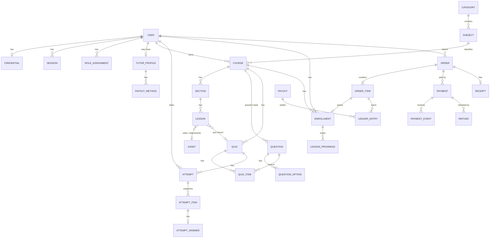
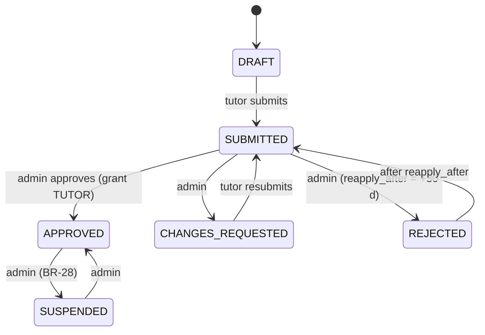
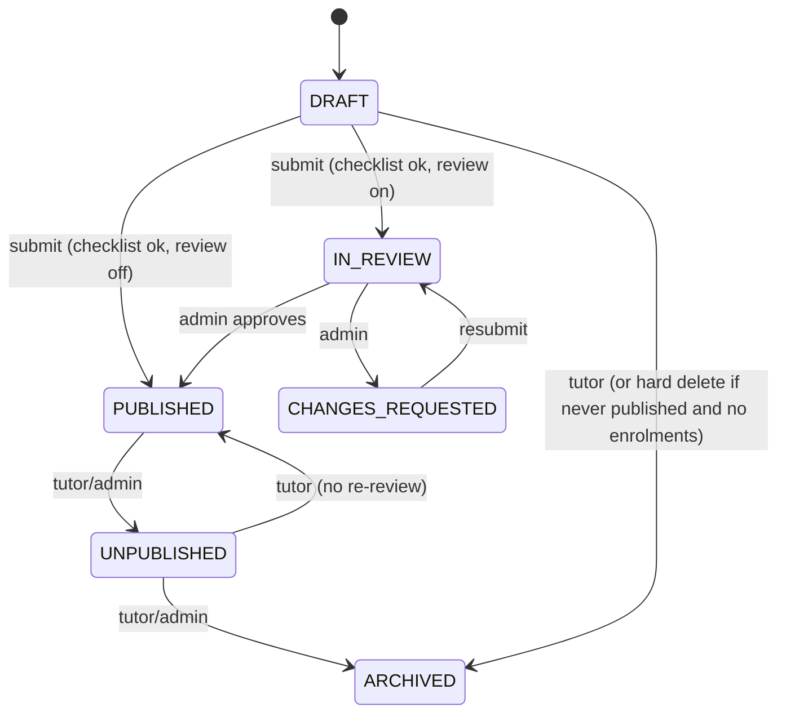
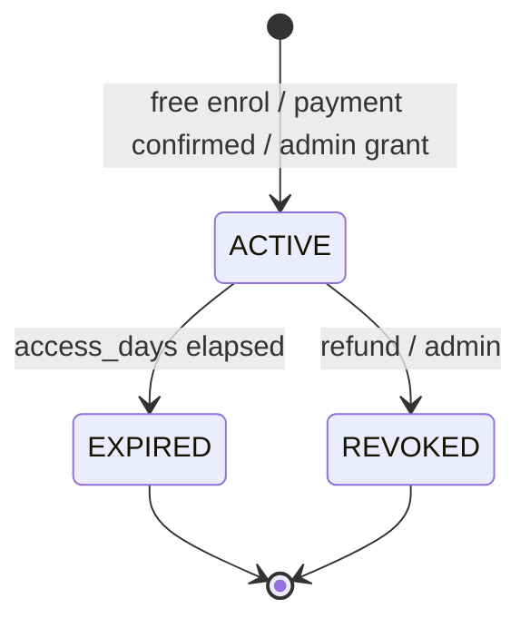
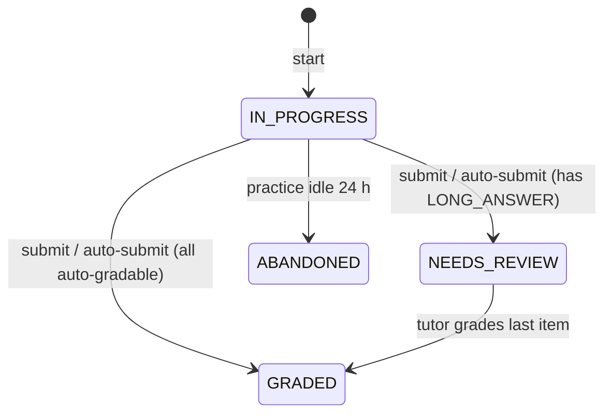
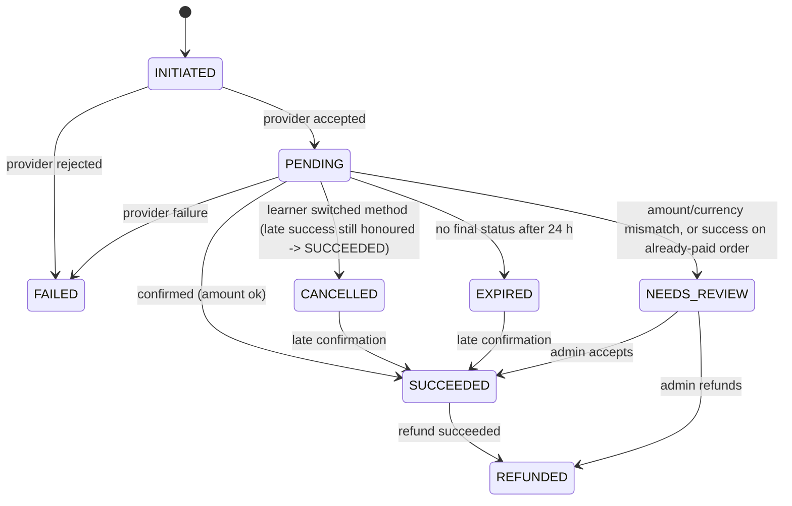
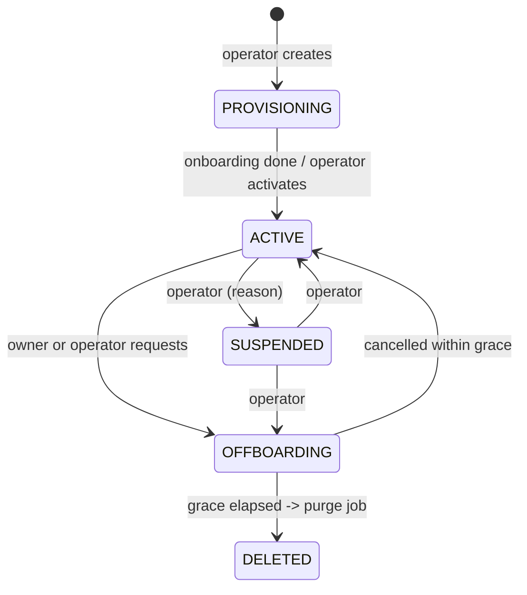

# 05 — Database and API Specification

> **Revision 4 (2026-10-11):** client approved tenancy decisions D1-D6: shared schema + forced RLS; no RLS-bypassing login role (NOLOGIN definer role + function inventory); global accounts with per-school memberships; sign-in on the school host and switching by one-time hand-off; Prisma + RLS go/no-go at 3 ms p95. D7 (legal controller role) remains open.
>
> **Revision 3 (2026-10-11):** ledger `platform_fee_minor` renamed `commission_minor` (instructor commission); plan pricing (`platformCommissionBps`); grouped tenant settings incl. languages, course and material defaults, payment settings; per-locale tenant texts; payment-account capabilities; new `domain_change_request`, `settlement_report`, `platform_statement`; endpoints for locales, domains, onboarding, capabilities, reconciliation, statements, video webhook.
>
> **Revision 2 (2026-10-11): multi-tenancy.** **§8 is authoritative for tenancy:** new entities, the `tenant_id` rule for every tenant-owned table, changed unique keys, RLS, and new tenant-admin and console endpoints. §3–§7 below describe each entity's *business* fields. Under revision 2, every entity not listed as global in §8.1 also gets `tenant_id`, composite tenant foreign keys and tenant-leading indexes, as specified in §8.2. `/admin/*` endpoints are **tenant-admin** endpoints.

All entities are **PROPOSED**. Concepts that come straight from client answers (course, material/lesson, quiz, question, practice, payment, tutor, learner) are **CONFIRMED concepts**. Their exact fields and rules are proposals. Entities that depend on open business decisions are marked with the question id.

## 1. Conventions

- PostgreSQL 17+. Table names `snake_case` singular. Prisma models `PascalCase` with `@@map`.
- Primary keys `uuid` (UUIDv7 generated in the app) unless noted.
- Every table has `created_at timestamptz not null default now()`. Mutable tables also have `updated_at` and, where concurrent editing matters, `version int not null default 1`.
- Money: `*_minor bigint` + `currency char(3)`, with `CHECK (amount >= 0)`.
- Enums: Postgres enums via Prisma.
- Soft delete only where stated; financial and audit tables are never deleted.
- Constraints that Prisma can't express (partial unique indexes, CHECK, triggers) are written as raw SQL in the migration and listed below.
- Sensitive fields: **[PII]** personal data, **[SECRET]** stored hashed or encrypted, **[FIN]** financial record (retention rules apply).

## 2. Entity relationship overview



## 3. Entities

### 3.1 Identity

**user** — every person.
| Field | Type | Rules |
|---|---|---|
| id | uuid PK | |
| email | citext | unique; **[PII]** |
| email_verified_at | timestamptz? | |
| display_name | text | 1–80 chars **[PII]** |
| phone_e164 | text? | E.164 **[PII]** (mobile-money default) |
| avatar_asset_id | uuid? FK asset | |
| status | enum `PENDING_VERIFICATION, ACTIVE, SUSPENDED, DELETION_REQUESTED, DELETED` | |
| locale / time_zone / theme / data_saver | text / text / enum / bool | defaults `en-ZM` / `Africa/Lusaka` / `SYSTEM` / false |
| terms_version, terms_accepted_at | text, timestamptz | consent record |
| deletion_requested_at, anonymised_at | timestamptz? | BR-27 |
Indexes: `unique(email)`, `(status)`. Access: self, admin.

**credential** — `user_id PK/FK`, `password_hash` **[SECRET]** (Argon2id), `password_changed_at`, `failed_count int`, `locked_until timestamptz?`, `totp_secret_enc bytea?` **[SECRET]** (AES-256-GCM, key in env), `totp_enabled_at`, `recovery_codes_hash text[]` **[SECRET]**.

**session** — `id`, `user_id FK`, `token_hash bytea unique` **[SECRET]**, `idle_expires_at`, `absolute_expires_at`, `last_seen_at`, `ip inet` **[PII]**, `user_agent`, `revoked_at?`. Index `(user_id) where revoked_at is null`. `last_seen_at` is updated at most once per 5 min per session.

**one_time_token** — `id`, `user_id`, `purpose enum VERIFY_EMAIL|RESET_PASSWORD|CHANGE_EMAIL`, `token_hash unique` **[SECRET]**, `payload jsonb` (e.g. the new email), `expires_at`, `used_at?`. A new token of the same purpose invalidates older ones.

**role_assignment** — PK `(user_id, role)`; `role enum LEARNER|TUTOR|ADMIN`; `granted_by`, `granted_at`. LEARNER is assigned at registration.

### 3.2 Profiles

**tutor_profile** — `user_id PK/FK`, `slug unique`, `headline (≤120)`, `bio_json`, `subjects text[]`, `qualifications_json`, `status enum DRAFT|SUBMITTED|CHANGES_REQUESTED|APPROVED|REJECTED|SUSPENDED`, `submitted_at`, `decided_by`, `decided_at`, `decision_note`, `agreement_version`, `reapply_after?`, `version`.



**payout_method** — `id`, `tutor_id FK`, `type enum MOBILE_MONEY|BANK`, `details_enc bytea` **[SECRET][PII]** (app-level encryption), `display_hint` (e.g. "Airtel ••• 412"), `is_default bool`, `created_at`. Partial unique `(tutor_id) where is_default`.

### 3.3 Catalogue and content

**category** `id, slug unique, name, position, archived_at?` · **subject** `id, category_id FK, slug unique, name, position, archived_at?`.

**course**
| Field | Type | Rules |
|---|---|---|
| id, owner_id (FK user), subject_id | uuid | `(owner_id)` index |
| slug | text | unique, generated from title, immutable once published (redirect table LATER) |
| title / subtitle | text | 5–120 / ≤200 |
| description_json | jsonb | ProseMirror doc |
| outcomes / requirements | text[] | 1–12 / 0–12 items, each ≤160 |
| level | enum `BEGINNER, INTERMEDIATE, ADVANCED, ALL_LEVELS` | |
| language | text | default `en` |
| tags | text[] | ≤5 |
| cover_asset_id | uuid? FK asset | |
| price_minor, currency | bigint, char(3) | `CHECK (price_minor >= 0)`; min price enforced by app (setting) |
| sale_price_minor, sale_ends_at | bigint?, timestamptz? | `CHECK (sale_price_minor < price_minor)` |
| access_days | int? | `CHECK (access_days > 0)` (Q-BIZ-4) |
| status | enum `DRAFT, IN_REVIEW, CHANGES_REQUESTED, PUBLISHED, UNPUBLISHED, ARCHIVED` | |
| first_published_at, published_at, archived_at | timestamptz? | |
| enrollment_count | int | denormalised, updated in tx |
| search_vector | tsvector | generated (title A, subtitle B, tags B, description C) |
| version | int | optimistic locking |
Indexes: `(status, subject_id, published_at desc)`, GIN `search_vector`, GIN trigram `title`, `(owner_id, status)`.



**course_submission** — moderation history: `id, course_id, submitted_by, submitted_at, checklist_snapshot jsonb, decision enum APPROVED|CHANGES_REQUESTED|REJECTED?, decided_by?, decided_at?, notes`.

**section** — `id, course_id FK (cascade), title (1–120), position int`. `unique(course_id, position) DEFERRABLE INITIALLY DEFERRED`.

**lesson**
| Field | Type | Rules |
|---|---|---|
| id, course_id, section_id | uuid | FKs; course_id kept for policy queries |
| title | text | 1–120 |
| type | enum `TEXT, VIDEO, FILE, QUIZ` | |
| position | int | `unique(section_id, position) DEFERRABLE` |
| content_json | jsonb? | TEXT body or VIDEO notes |
| video_asset_id | uuid? FK asset | required when type=VIDEO (CHECK) |
| quiz_id | uuid? FK quiz | required when type=QUIZ (CHECK) |
| is_preview, is_required, downloadable | bool | defaults false, true, false |
| duration_seconds | int? | from video or estimated reading time |
| version | int | |

**lesson_attachment** — PK `(lesson_id, asset_id)`, `position`.

**asset** (an upload slot is an asset in `PENDING_UPLOAD`)
| Field | Type | Rules |
|---|---|---|
| id, owner_id | uuid | |
| kind | enum `IMAGE, DOCUMENT, VIDEO` | |
| purpose | enum `COURSE_COVER, AVATAR, LESSON_FILE, LESSON_IMAGE, LESSON_VIDEO, QUESTION_IMAGE, RECEIPT, EXPORT` | drives the allowlist |
| storage_key | text? | private bucket key |
| provider_video_id | text? | video service id |
| original_name, mime, size_bytes, checksum_sha256 | | size CHECK by purpose in app |
| status | enum `PENDING_UPLOAD, UPLOADED, SCANNING, PROCESSING, READY, REJECTED` | |
| reject_reason, width, height, duration_seconds | | |
| expires_at | timestamptz? | pending slots expire after 1 h → cleanup |
Index `(owner_id, status)`, `(status, created_at)` for cleanup.

### 3.4 Learning

**enrollment**
| Field | Type | Rules |
|---|---|---|
| id, user_id, course_id | uuid | |
| source | enum `FREE, PURCHASE, ADMIN_GRANT` | |
| order_item_id | uuid? FK | required when source=PURCHASE (CHECK) |
| status | enum `ACTIVE, EXPIRED, REVOKED` | |
| started_at, expires_at?, revoked_at?, revoke_reason?, granted_by? | | |
| progress_percent | smallint | 0–100, updated in the progress tx |
| completed_at? | timestamptz | BR-22 |
| last_lesson_id?, last_accessed_at? | | resume |
**Partial unique** `(user_id, course_id) WHERE status = 'ACTIVE'` (BR-07, F14). Indexes `(course_id, status)`, `(user_id, last_accessed_at desc)`.


A new enrolment (e.g. a repurchase) is a new row. History is kept.

**lesson_progress** — PK `(enrollment_id, lesson_id)`; `status enum NOT_STARTED|IN_PROGRESS|COMPLETED`; `position_seconds int`; `completed_at?`; `updated_at`.

### 3.5 Assessment

**question**
| Field | Type | Rules |
|---|---|---|
| id, course_id, created_by | uuid | |
| type | enum `SINGLE_CHOICE, MULTIPLE_CHOICE, TRUE_FALSE, SHORT_ANSWER, NUMERIC, LONG_ANSWER` | |
| stem_json, explanation_json? | jsonb | |
| points | numeric(6,2) | `> 0` |
| difficulty | enum `EASY, MEDIUM, HARD` | |
| tags | text[] | GIN index |
| practice_eligible | bool | forced false for LONG_ANSWER |
| settings | jsonb | per type: `{partialCredit}`, `{acceptedAnswers[], caseSensitive}`, `{value, tolerance}` |
| status | enum `ACTIVE, ARCHIVED` | |
| version | int | |
Index `(course_id, status, type)`.

**question_option** — `id, question_id FK (cascade), position, content_json, is_correct bool, feedback_json?`. Validation (application, in the save transaction): SINGLE_CHOICE and TRUE_FALSE have exactly one correct option; MULTIPLE_CHOICE has ≥1; 2–10 options.

**quiz** — `id, course_id, title, instructions_json, selection_mode enum FIXED|DRAW, time_limit_seconds? CHECK 60–36000, attempts_allowed? CHECK ≥1, pass_mark_percent? CHECK 0–100, shuffle_questions, shuffle_options, opens_at?, closes_at? CHECK (opens_at < closes_at), feedback_policy enum IMMEDIATE|AFTER_CLOSE|NEVER, show_correct_answers bool, status enum DRAFT|READY, version`.

**quiz_item** — PK `(quiz_id, question_id)`, `position`, `points_override numeric?`.
**quiz_draw_rule** (SHOULD) — `id, quiz_id, count int ≥1, tags text[], difficulty?, types enum[]?`.

**attempt**
| Field | Type | Rules |
|---|---|---|
| id, user_id, course_id | uuid | |
| quiz_id | uuid? | null for practice |
| mode | enum `ASSESSED, PRACTICE` | |
| attempt_number | int? | assessed only; `unique(user_id, quiz_id, attempt_number)` |
| status | enum `IN_PROGRESS, NEEDS_REVIEW, GRADED, ABANDONED` | ABANDONED only for practice |
| started_at, deadline_at?, submitted_at? | timestamptz | |
| submit_kind | enum `MANUAL, AUTO`? | |
| score, max_score | numeric(8,2) | |
| percent | numeric(5,2) | |
| passed | bool? | null when there is no pass mark |
| settings_snapshot | jsonb | feedback policy, pass mark, show answers, closes_at |
| graded_at?, graded_by? | | |
**Partial unique** `(user_id, quiz_id) WHERE status = 'IN_PROGRESS' AND mode = 'ASSESSED'` (BR-16). Indexes `(quiz_id, status)`, `(user_id, course_id, started_at desc)`, `(status, deadline_at)` for the auto-submit safety sweep.



**attempt_item** — `id, attempt_id FK, position, question_id (reference only), question_snapshot jsonb` (type, stem, options with ids and `isCorrect`, settings, explanation), `points numeric`. The **public projection** of the snapshot strips `isCorrect`, `acceptedAnswers`, `value`, `tolerance` and `explanation` (BR-20).

**attempt_answer** — PK `attempt_item_id`; `response jsonb` (`{optionIds:[]}` | `{text}` | `{number}`); `client_seq int`; `saved_at`; `is_correct bool?`; `awarded_points numeric?`; `grader_comment?`; `graded_by?`; `graded_at?`.

### 3.6 Commerce **[FIN]**

**order** — `id, user_id, status enum PENDING|PAID|EXPIRED|CANCELLED|REFUNDED, currency, total_minor, expires_at, paid_at?, created_at, version`. Index `(user_id, created_at desc)`, `(status, expires_at)`.
**order_item** — `id, order_id, course_id, tutor_id, title_snapshot, unit_price_minor, currency`. First release: exactly one item per order (application rule); the schema allows a cart later.

**payment**
| Field | Type | Rules |
|---|---|---|
| id, order_id | uuid | |
| provider | text | e.g. `aggregator_x`, `fake` |
| method | enum `MOBILE_MONEY, CARD` | |
| network | enum `MTN, AIRTEL, ZAMTEL`? | mobile money |
| msisdn_enc / msisdn_masked | bytea / text | **[PII]** |
| reference | text unique | our UUID sent to the provider |
| provider_transaction_id | text? | `unique(provider, provider_transaction_id)` |
| amount_minor, currency | | |
| provider_fee_minor | bigint? | |
| status | enum `INITIATED, PENDING, SUCCEEDED, FAILED, EXPIRED, CANCELLED, NEEDS_REVIEW, REFUNDED` | |
| failure_code, failure_message | text? | normalised codes (e.g. `INSUFFICIENT_FUNDS`, `USER_DECLINED`, `TIMEOUT`) |
| next_check_at, check_count | timestamptz, int | reconciliation schedule |
| confirmed_at | timestamptz? | |
**Partial unique** `(order_id) WHERE status IN ('INITIATED','PENDING')` (BR-36). Index `(status, next_check_at)`.



Order transitions: `PENDING → PAID` (payment SUCCEEDED), `PENDING → EXPIRED` (job), `PENDING → CANCELLED` (learner), `EXPIRED → PAID` (late success, F25 recovery), `PAID → REFUNDED`.

**payment_event** — `id, provider, provider_event_id, payment_id?, type, payload jsonb, signature_valid bool, received_at, processed_at?, processing_error?`. `unique(provider, provider_event_id)`. Retained 2 years, then the payload is purged.

**refund** — `id, order_id, payment_id, amount_minor (= paid, full refunds only in the first release), reason, mode enum PROVIDER|MANUAL, status enum PROCESSING|SUCCEEDED|FAILED, provider_refund_id?, manual_reference?, requested_by, approved_by, created_at, completed_at?`.

**receipt** — `id, order_id unique, number text unique, year int, seq int, issued_at, pdf_asset_id?`. **receipt_sequence** — `year PK, last_value int` incremented with `UPDATE … RETURNING` inside the confirmation transaction (gap-free, BR-33).

**idempotency_key** — PK `(user_id, key)`, `route`, `request_hash`, `response_status`, `response_body jsonb`, `created_at` (purged after 24 h).

### 3.7 Ledger **[FIN]**

**ledger_entry**
| Field | Type | Rules |
|---|---|---|
| id | uuid | |
| tutor_id, order_item_id | uuid | |
| refund_id | uuid? | for reversals |
| type | enum `SALE, REFUND_REVERSAL, ADJUSTMENT` | |
| gross_minor, provider_fee_minor, commission_minor, net_minor | bigint (signed) | `CHECK (gross_minor - provider_fee_minor - commission_minor = net_minor)`; `commission_minor` is the **instructor commission** kept by the tenant (rev. 3 rename of `platform_fee_minor`, BR-63) |
| currency | char(3) | |
| status | enum `PENDING, AVAILABLE, PAID, FROZEN` | forward-only transitions |
| available_at | timestamptz | created + refund window |
| payout_id | uuid? | |
| note, created_by | | ADJUSTMENT requires a note |
Amount columns are **immutable**: a trigger rejects UPDATE of amount and type columns, and DELETE is revoked from the app role. Index `(tutor_id, status)`, `unique(order_item_id) WHERE type='SALE'`.

**payout** — `id, tutor_id, amount_minor, currency, method_snapshot jsonb (display hint only), external_reference, paid_at, recorded_by, note`. `amount_minor = sum(net_minor of linked entries)` is verified in the recording transaction.

### 3.8 Platform

**notification** — `id, user_id, type, data jsonb, read_at?, created_at`; index `(user_id, read_at, created_at desc)`; retained 180 days.
**notification_preference** — PK `(user_id, key)`, `email_enabled bool`.
**outbox** — `id bigint identity, topic, payload jsonb, created_at, dispatched_at?, attempts, last_error`; index `(dispatched_at) WHERE dispatched_at IS NULL`.
**audit_log** — `id bigint identity, actor_id?, actor_roles text[], action text (e.g. course.approved), entity_type, entity_id, before jsonb?, after jsonb?, ip inet, user_agent, request_id, created_at`; indexes `(entity_type, entity_id, created_at)`, `(actor_id, created_at)`, `(action, created_at)`; UPDATE and DELETE revoked from the app role.
**platform_setting** — `key PK, value jsonb, updated_by, updated_at` (typed in code by a Zod schema; includes feature flags).

## 4. API inventory (`/api/v1`)

Roles: V visitor, L learner, T tutor (owner), A admin. "Owner" means the policy checks ownership. Every mutation is audited where F34 requires it.

### 4.1 Auth and account
| Method & route | Purpose | Roles | Notes |
|---|---|---|---|
| POST `/auth/register` | Create account | V | 202 generic; rate-limited |
| POST `/auth/verify-email` | Confirm token | V/L | single-use |
| POST `/auth/verify-email/resend` | Resend | L | 3/hour |
| POST `/auth/sign-in` | Start session | V | sets cookie; lockout rules |
| POST `/auth/sign-out` | End session | L | |
| POST `/auth/password/forgot` · `/auth/password/reset` | Reset flow | V | generic responses |
| GET `/me` | Current user + roles + flags | L | |
| PATCH `/me` | Profile and preferences | L | |
| POST `/me/email-change` | Start email change | L | requires password |
| POST `/me/password` | Change password | L | revokes other sessions |
| GET `/me/sessions` · DELETE `/me/sessions/{id}` · DELETE `/me/sessions` | Session management | L | |
| POST `/me/2fa/setup` · `/me/2fa/enable` · `/me/2fa/disable` | TOTP (SHOULD) | L/A | |
| POST `/me/data-export` | Request export (SHOULD) | L | async |
| POST `/me/deletion` · DELETE `/me/deletion` | Request or cancel deletion | L | 30-day grace |
| GET `/me/notifications` · POST `/me/notifications/read` | Notification centre | L | |

### 4.2 Tutors
| Method & route | Purpose | Roles |
|---|---|---|
| GET/PUT `/me/tutor-application` · POST `/me/tutor-application/submit` | Draft and submit application | L (verified) |
| GET/POST/DELETE `/me/payout-methods` | Manage payout methods | T |
| GET `/tutors/{slug}` | Public profile + published courses | V |
| GET `/me/earnings/summary` · `/me/earnings/entries` · `/me/payouts` | Balances, statement, payouts (+ `?format=csv`) | T |

### 4.3 Catalogue (public)
| Method & route | Purpose | Roles |
|---|---|---|
| GET `/categories` | Category tree | V |
| GET `/courses?q=&filter[subject]=&filter[level]=&filter[price]=free|paid&sort=` | Search and browse | V |
| GET `/courses/{slug}` | Landing page data (outline titles, preview flags, price, tutor, `viewer`: enrolment state + allowedActions) | V |

### 4.4 Studio (tutor authoring)
| Method & route | Purpose | Roles |
|---|---|---|
| GET/POST `/studio/courses` | List own / create | T |
| GET/PATCH/DELETE `/studio/courses/{id}` | Details (If-Match) | T owner, A |
| GET `/studio/courses/{id}/outline` · PUT `/studio/courses/{id}/outline/order` | Outline; reorder sections and lessons in one call | T owner |
| POST/PATCH/DELETE `/studio/courses/{id}/sections[/{sid}]` | Sections | T owner |
| POST/PATCH/DELETE `/studio/courses/{id}/lessons[/{lid}]` | Lessons | T owner |
| GET `/studio/courses/{id}/publish-checklist` | Checklist evaluation | T owner |
| POST `/studio/courses/{id}/submit` · `/unpublish` · `/publish` · `/archive` | Workflow | T owner |
| GET/POST `/studio/courses/{id}/questions` · GET/PATCH/DELETE `/studio/questions/{qid}` | Question bank | T owner |
| POST `/studio/courses/{id}/questions/import` | CSV import, dry-run first (SHOULD) | T owner |
| GET/POST `/studio/courses/{id}/quizzes` · GET/PATCH/DELETE `/studio/quizzes/{id}` · PUT `/studio/quizzes/{id}/items` | Quizzes | T owner |
| GET `/studio/courses/{id}/learners` | Enrolled learners + progress | T owner |
| GET `/studio/quizzes/{id}/attempts` · GET `/studio/attempts/{id}` | Results | T owner |
| GET `/studio/courses/{id}/grading-queue` · PUT `/studio/attempts/{id}/items/{itemId}/grade` | Manual grading | T owner |
| GET `/studio/quizzes/{id}/analytics` | Analytics (SHOULD) | T owner |

### 4.5 Media
| Method & route | Purpose | Roles |
|---|---|---|
| POST `/uploads` | Create upload slot (presigned PUT) | L (avatar), T |
| POST `/uploads/{id}/complete` | Trigger scan | owner |
| POST `/videos` | Create video + direct upload URL | T |
| GET `/assets/{id}` | Status (for polling while processing) | owner, A |
| POST `/webhooks/video/{provider}` | Video status webhook | provider (signature) |

### 4.6 Learning
| Method & route | Purpose | Roles |
|---|---|---|
| POST `/courses/{id}/enrol` | Free enrolment | L |
| GET `/me/enrollments` | My learning | L |
| GET `/learn/courses/{id}` | Player bootstrap: outline + progress + resume point | enrolled, owner, A |
| GET `/learn/lessons/{id}` | Lesson content (sanitised HTML + metadata) | enrolled / preview / owner / A |
| GET `/learn/lessons/{id}/playback` | Signed video playback token | same |
| GET `/learn/lessons/{id}/files/{assetId}/url` | Signed download URL | same |
| PUT `/learn/lessons/{id}/progress` | `{status?, positionSeconds?}` | enrolled |

### 4.7 Assessment (learner)
| Method & route | Purpose | Roles |
|---|---|---|
| GET `/learn/quizzes/{id}` | Intro: rules, attempts used and left, availability, best result | enrolled |
| POST `/learn/quizzes/{id}/attempts` | Start (or resume) | enrolled |
| GET `/learn/attempts/{id}` | Resume: items (public projection), answers, deadline, serverNow | attempt owner |
| PUT `/learn/attempts/{id}/answers/{itemId}` | Save answer | attempt owner; rate limit 5/s |
| POST `/learn/attempts/{id}/submit` | Submit | attempt owner |
| GET `/learn/attempts/{id}/result` | Result + review (policy-filtered) | attempt owner, T owner, A |
| GET `/learn/quizzes/{id}/attempts` | My attempt history | L |
| POST `/learn/courses/{id}/practice` | Start practice `{count, tags?, difficulty?, mistakesOnly?}` | enrolled |
| PUT `/learn/practice/{attemptId}/answers/{itemId}` | Answer + **immediate** feedback | owner |
| POST `/learn/practice/{attemptId}/finish` | Summary | owner |

### 4.8 Commerce
| Method & route | Purpose | Roles |
|---|---|---|
| POST `/orders` | Create or reuse order (Idempotency-Key) | L (verified) |
| GET `/orders/{id}` | Status (polled) | order owner, A |
| POST `/orders/{id}/payments` | Start payment `{method, msisdn?, network?}` (Idempotency-Key) | order owner |
| POST `/orders/{id}/cancel` | Cancel pending order | order owner |
| GET `/me/orders` · GET `/me/orders/{id}/receipt` | History and receipt (PDF or HTML) | L |
| POST `/me/orders/{id}/refund-request` | Request refund (SHOULD) | L |
| POST `/webhooks/payments/{provider}` | Provider callback | provider (signature) |
| GET `/payments/return?ref=` | Return landing → redirects to order status page | V/L |

### 4.9 Tenant admin (`/admin/*` on the tenant host, roles TENANT_ADMIN/TENANT_OWNER, all mutations audited in the tenant audit log)
| Area | Endpoints |
|---|---|
| Users | GET `/admin/users?q=`, GET `/admin/users/{id}`, POST `/admin/users/{id}/suspend` · `/unsuspend`, PUT `/admin/users/{id}/roles`, POST `/admin/users/{id}/enrollments` (grant), DELETE `/admin/enrollments/{id}` (revoke) |
| Queues | GET `/admin/queues/summary`; GET `/admin/tutor-applications?status=`, POST `/admin/tutor-applications/{userId}/decision`; GET `/admin/course-submissions?status=`, POST `/admin/course-submissions/{id}/decision`; GET `/admin/payment-exceptions`, POST `/admin/payments/{id}/resolve` |
| Commerce | GET `/admin/orders?…`, GET `/admin/orders/{id}` (payments, events, refunds, ledger), POST `/admin/orders/{id}/refunds` (Idempotency-Key), POST `/admin/payments/{id}/recheck` |
| Ledger | GET `/admin/earnings?tutorId=&status=`, POST `/admin/payouts` `{tutorId, entryIds[], externalReference, paidAt}`, GET `/admin/payouts` |
| Catalogue | CRUD `/admin/categories`, `/admin/subjects`; POST `/admin/courses/{id}/unpublish` |
| Reports | GET `/admin/reports/overview?from=&to=`, POST `/admin/exports` `{type, from, to}` → GET `/admin/exports/{id}` |
| Platform | GET/PUT `/admin/settings`, GET `/admin/audit-log?…` |

### 4.10 Operations
GET `/healthz` (liveness), GET `/readyz` (DB and storage), GET `/api/docs` (non-production).

## 5. Representative contracts

**Create order**
```http
POST /api/v1/orders
Idempotency-Key: 6f1c2f0e-3b3c-4c55-9a4a-8d1f0b8d2a11
Content-Type: application/json

{ "courseId": "01928f6e-7c1a-7b3e-9a40-2f6d1c3e5a77" }
```
```json
201 Created
{
  "id": "01928f70-1d22-7d0a-8c11-4b5e6f7a8b9c",
  "status": "PENDING",
  "expiresAt": "2026-10-11T10:30:00Z",
  "total": { "amountMinor": 25000, "currency": "ZMW" },
  "items": [{ "courseId": "01928f6e-…", "title": "Grade 12 Biology: Cells to Systems",
              "unitPrice": { "amountMinor": 25000, "currency": "ZMW" } }],
  "allowedActions": ["pay", "cancel"]
}
```
Errors: 409 `ALREADY_ENROLLED`, 403 `EMAIL_NOT_VERIFIED`, 422 `COURSE_NOT_PURCHASABLE` (not published, free, or own course).

**Start mobile-money payment**
```json
POST /api/v1/orders/{id}/payments
{ "method": "MOBILE_MONEY", "msisdn": "+260971234567", "network": "MTN" }

202 Accepted
{ "paymentId": "01928f71-…", "status": "PENDING",
  "nextAction": { "type": "APPROVE_ON_PHONE", "network": "MTN", "maskedMsisdn": "+260 97 ••• 567",
                  "message": "Check your phone and enter your PIN to approve K250.00." },
  "pollAfterMs": 3000 }
```
Card variant: `"nextAction": { "type": "REDIRECT", "url": "https://checkout.provider.example/…" }`.
Errors: 422 `VALIDATION_FAILED` (bad number), 409 `ORDER_NOT_PAYABLE` (expired, paid), 503 `PAYMENT_PROVIDER_UNAVAILABLE`.

**Start quiz attempt**
```json
POST /api/v1/learn/quizzes/{quizId}/attempts
201 Created
{
  "id": "01928f80-…", "status": "IN_PROGRESS", "attemptNumber": 2, "attemptsAllowed": 3,
  "startedAt": "2026-10-11T09:00:00Z", "deadlineAt": "2026-10-11T09:20:00Z", "serverNow": "2026-10-11T09:00:00.412Z",
  "items": [
    { "id": "itm_1", "position": 1, "type": "SINGLE_CHOICE", "points": 1,
      "stemHtml": "<p>Which organelle produces ATP?</p>",
      "options": [ { "id": "o_a", "html": "<p>Ribosome</p>" }, { "id": "o_b", "html": "<p>Mitochondrion</p>" } ] }
  ],
  "answers": {}
}
```
(No `isCorrect`, no explanation. Returns 200 with the existing attempt if one is already in progress. Errors: 409 `ATTEMPT_LIMIT_REACHED`, 409 `QUIZ_NOT_OPEN`, 403 `ENROLMENT_INACTIVE`.)

**Save answer**
```json
PUT /api/v1/learn/attempts/{id}/answers/itm_1
{ "response": { "optionIds": ["o_b"] }, "clientSeq": 7 }
200 { "savedAt": "2026-10-11T09:03:12Z", "clientSeq": 7 }
```
409 `ATTEMPT_CLOSED` after the deadline + grace; a stale `clientSeq` → 200 with the stored seq (ignored, idempotent).

**Error shape**
```json
422 Unprocessable Content
Content-Type: application/problem+json
{ "type": "https://studyhub.example/errors/validation-failed", "title": "Some fields need attention",
  "status": 422, "code": "VALIDATION_FAILED", "requestId": "req_01928f…",
  "errors": [ { "field": "msisdn", "code": "INVALID_PHONE", "message": "Enter a Zambian mobile number, e.g. 097 123 4567." } ] }
```

**Payment webhook processing (pseudo-contract)**
1. `POST /webhooks/payments/{provider}` with raw body and provider signature header.
2. Verify the signature over the raw bytes (constant-time compare) → 401 if invalid.
3. `INSERT payment_event … ON CONFLICT (provider, provider_event_id) DO NOTHING` → enqueue `payments.process-event` → `200 {}` within 1 s.
4. The job loads the payment by `reference`, calls `provider.getStatus(reference)`, then applies the state machine in one transaction.

## 6. Data lifecycle and retention (ASSUMED until Q-LEG-1 is answered)

| Data | Retention | On account deletion |
|---|---|---|
| user, profile, preferences | While active | Anonymised: email → `deleted+<id>@invalid`, name → "Deleted user", phone null, avatar deleted |
| sessions, tokens | Expired + 30 days | Deleted immediately |
| enrolments, progress, attempts | While active | Kept but detached from identity (anonymised user) so tutor analytics stay correct |
| orders, payments, refunds, receipts, ledger, payouts **[FIN]** | 7 years (ASSUMED statutory) | Kept; personal fields minimised (masked MSISDN) |
| payment_event payloads | 2 years, then payload nulled | Same |
| audit_log | 2 years minimum (ASSUMED) | Actor id kept (pseudonymous) |
| assets | While referenced; orphaned pending slots purged after 24 h; deleted course assets after 90 days | Avatar deleted; tutor course assets follow course archive rules |
| notifications | 180 days | Deleted |
| logs (technical) | 30 days | n/a |
| backups | PITR 7 days, snapshots 14 days, dumps 30 days | Deletions propagate as backups age out (stated in the privacy policy) |

## 7. Migration and compatibility considerations

- **No legacy data to migrate** (VERIFIED: there is no existing system). No `legacy_id` columns are needed.
- **Tutor content import** (likely, since tutors often have existing question sets): CSV question import (F17 SHOULD) with a documented template; bulk course import is LATER.
- **Payment provider switch:** provider-specific data lives only in `payment.provider`, `provider_transaction_id` and `payment_event.payload`; domain status is normalised, so switching providers needs a new adapter only.
- **Currency:** single currency per deployment. Multi-currency would need price-per-currency and FX policy (Q-BIZ-7). The `currency` columns already exist everywhere to keep that open.
- **Future mobile app:** the API is client-agnostic. For mobile, add a token-based session variant (same `session` table, `Authorization: Bearer` with an opaque token) without changing business endpoints. Under tenancy, a mobile app must also send the tenant host it acts for (e.g. a white-label app per tenant, or a tenant picker); the API maps it through the same resolver.
- **Tenant onboarding imports** (revision 2): schools will often bring learner lists. Add CSV import of learners and instructors as invitations (F42, SHOULD), with a dry-run report and plan-limit checks.

## 8. Multi-tenancy data model and API (revision 2, authoritative)

### 8.1 Global (platform-level) entities: no `tenant_id`; platform tables without RLS, identity tables with self/member RLS (rev. 4)

**Global identity (rev. 4, D3):**

**user_account** — `id uuid PK, email citext UNIQUE, email_verified_at?, display_name, default_locale, status ACTIVE|LOCKED|DELETION_REQUESTED|DELETED, deletion_requested_at?, anonymised_at?, created_at, updated_at, version`. RLS: visible if `id = app.user_id` **or** a `tenant_membership` row for this user exists in the current tenant (the membership table is itself under RLS). Sign-in never reads it directly; it uses `auth_lookup(email)`.

**credential** — `user_id PK/FK, password_hash, password_changed_at, failed_count, locked_until?, totp_secret_enc?, totp_enabled_at?, recovery_codes_hash[]`. RLS: `user_id = app.user_id` only.

**one_time_token** — `id, user_id, purpose VERIFY_EMAIL|RESET_PASSWORD|CHANGE_EMAIL, token_hash UNIQUE, payload jsonb, context_tenant_id? (branding of the host where it was requested), expires_at, used_at?`. RLS: self only; redemption goes through a definer function.

**tenant_handoff** — `id, user_id, target_tenant_id, token_hash UNIQUE, created_at, expires_at (= created_at + 60 s), used_at?`. CHECK `expires_at <= created_at + interval '60 seconds'`. Created on the source host for the caller only; redeemed only via `exchange_handoff()` on the target host (BR-68).

**Platform tables (no RLS):**

**tenant**
| Field | Type | Rules |
|---|---|---|
| id | uuid PK | |
| slug | citext | unique; BR-50; reserved list check |
| name, legal_name | text | 2–120 |
| kind | enum `SCHOOL, COLLEGE, UNIVERSITY, TUTORING_BUSINESS, INDEPENDENT_TUTOR, MARKETPLACE, OTHER` | informational, also drives onboarding templates |
| status | enum `PROVISIONING, ACTIVE, SUSPENDED, OFFBOARDING, DELETED` | |
| plan_id | uuid FK plan | |
| country, currency, locale, time_zone | char(2), char(3), text, text | defaults ZM, ZMW, en-ZM, Africa/Lusaka (ASSUMED) |
| receipt_prefix | text | 2–8 uppercase, unique |
| suspended_reason, offboarding_requested_at, delete_after | | |
| created_by (platform_user), created_at, updated_at, version | | |



**tenant_domain** — `id, tenant_id FK, hostname citext unique, type enum SUBDOMAIN|CUSTOM, status enum PENDING_VERIFICATION|ACTIVE|FAILED|REDIRECT, verification_token, verified_at, is_primary bool, redirect_until?`. Partial unique `(tenant_id) WHERE is_primary`. The app role reads only through `resolve_tenant(host) → (tenant_id, status, primary_host)`.

**plan** — `id, code unique, name, features jsonb (feature keys → bool), limits jsonb ({maxActiveLearners, maxInstructors, maxAdmins, storageGb, videoMinutesPerMonth, hardBlockVideo, maxDocumentMb, maxVideoGb}), pricing jsonb ({subscriptionFeeMinor, currency, platformCommissionBps (default 0, BR-63)}) (rev. 3), is_public, status ACTIVE|RETIRED, version`.

**platform_user / platform_credential / platform_session** — the same shapes as the tenant identity tables (05 §3.1) without `tenant_id`; `platform_user.role enum PLATFORM_OWNER|PLATFORM_OPERATOR|PLATFORM_SUPPORT`; TOTP mandatory (`totp_enabled_at NOT NULL` before any console access beyond enrolment).

**platform_audit_log** — the same shape as `audit_log` plus `tenant_id?` (the tenant affected). Append-only.

**platform_setting** — unchanged (global settings only).

### 8.2 Tenant-owned entities

**Rule:** every entity in §3 except the global identity tables in §8.1 (`session`, `tutor_profile`, `payout_method`, `category`, `subject`, `course`, `course_submission`, `section`, `lesson`, `lesson_attachment`, `asset`, `enrollment`, `lesson_progress`, `question`, `question_option`, `quiz`, `quiz_item`, `quiz_draw_rule`, `attempt`, `attempt_item`, `attempt_answer`, `order`, `order_item`, `payment`, `payment_event`, `refund`, `receipt`, `receipt_sequence`, `idempotency_key`, `ledger_entry`, `payout`, `notification`, `notification_preference`, `outbox`, `audit_log`) gains the following:
- `tenant_id uuid NOT NULL`
- RLS enabled and forced, with the `tenant_isolation` policy (04 §17.4)
- `UNIQUE (tenant_id, id)` on tables referenced by others
- composite FKs `(tenant_id, parent_id)`
- `tenant_id` as the first column of every index

Changed keys:

| Revision 1 key | Revision 2 key |
|---|---|
| `user.email` unique | **rev. 4:** `user_account.email` stays globally unique (one account per person, D3). Registration, invitation and reset responses are generic to prevent enumeration (BR-65, BR-66) |
| `course.slug`, `category.slug`, `subject.slug`, `tutor_profile.slug` unique | `unique(tenant_id, slug)` |
| `receipt_sequence(year)` PK | PK `(tenant_id, year)`; receipt number = `{tenant.receipt_prefix}-{year}-{seq:06}`; `unique(tenant_id, number)` |
| `payment.reference` unique | stays globally unique (UUID) so provider callbacks can be routed; `unique(payment_account_id, provider_transaction_id)` |
| `payment_event unique(provider, provider_event_id)` | `unique(payment_account_id, provider_event_id)` |
| `role_assignment` PK `(user_id, role)` | **rev. 4:** replaced by `tenant_membership` + `membership_role` (below); role enum `LEARNER, INSTRUCTOR, TENANT_ADMIN, TENANT_OWNER` |
| `session` | tenant-owned; adds `membership_id` (FK, composite with tenant) and `support_grant_id?` (support sessions, user_id and membership_id null for those, CHECK) |
| `asset.storage_key` | prefix `t/{tenant_id}/…` (CHECK `storage_key LIKE 't/' || tenant_id || '/%'`) |
| `platform_setting` keys used for fee, review, refund window, order expiry | moved to `tenant_setting` |

New tenant-owned entities:

**tenant_branding** — `tenant_id PK/FK, version int, status DRAFT|PUBLISHED, display_name, logo_asset_id?, logo_dark_asset_id?, favicon_asset_id?, app_icon_asset_id?, accent_hex, derived_tokens jsonb (compiled light and dark values + measured contrast ratios), font_preset enum COPPERLINE|HUMANIST|GEOMETRIC, home_layout jsonb, footer_links jsonb, support_email, support_phone, social jsonb, terminology jsonb, email_from_name (rev. 3: **all tenant-authored text fields — hero and section texts in `home_layout`, footer link labels, terminology, email_from_name — are stored per locale as `{ "en": "…" }`**, BR-61), show_powered_by bool, published_at, published_by`. History lives in **tenant_branding_version** (`tenant_id, version, snapshot jsonb, published_by, published_at`) for rollback.

**tenant_setting** — PK `(tenant_id, key)`, `value jsonb`, `updated_by`, `updated_at`. Keys and types come from a Zod schema (revision 3 grouping):
- **Languages and locale:** `defaultLocale`, `enabledLocales[]` (subset of shipped locales; must contain `defaultLocale`), `timeZone`.
- **Learners and catalogue:** `learnerRegistrationMode`, `allowedEmailDomains[]`, `catalogVisibility`, `unverifiedFreeEnrolment`.
- **Instructors and review:** `instructorOnboardingMode`, `courseReviewRequired`.
- **Course and material defaults (BR-64):** `allowedUploadTypes[]` (subset of the platform allowlist), `maxDocumentMb`, `maxVideoGb` (≤ plan), `downloadsAllowedDefault`, `videoCompletionThresholdPct` (50–100, default 90), `defaultAccessDays?`, `quizDefaults{feedbackPolicy, attemptsAllowed?, passMarkPercent?, shuffleQuestions, shuffleOptions}`, `practiceDefaults{questionsPerSession, mistakesModeEnabled}`.
- **Commerce (BR-62):** `enabledPaymentMethods[]` (⊆ `payment_account.capabilities.methods`), `minPaidPriceMinor`, `orderExpiryMinutes`, `refundWindowDays`, `refundMode` (`PROVIDER_API` only if supported, else `MANUAL`), `instructorCommissionBps` (only with `instructorRevenueShare`; renamed from `platformFeeBps`), `payoutSchedule`, `receiptSeller{legalName, address, taxId?}`.
- **Legal:** `legalPages{terms, privacy, refunds}`, each per locale.

**tenant_feature** — PK `(tenant_id, feature_key)`, `enabled_by_tenant bool`, `platform_override enum NONE|GRANT|REVOKE`, `updated_by`, `updated_at`. Written by the tenant (enabled flag) and the console (override), audited separately.

**tenant_membership** (rev. 4, D3) — `id, tenant_id, user_id (FK user_account), status INVITED|ACTIVE|SUSPENDED|REVOKED, display_name_override?, student_number?, joined_at?, suspended_at?, revoked_at?, revoked_by?, version`. `unique(tenant_id, user_id)`; `UNIQUE (tenant_id, id)` for composite FKs. Status changes to SUSPENDED or REVOKED delete that user's sessions in the tenant in the same transaction (BR-69).

**membership_role** (rev. 4) — PK `(tenant_id, membership_id, role)`; `granted_by`, `granted_at`. A tenant must always keep at least one ACTIVE `TENANT_OWNER` membership (BR-58).

**invitation** — `id, tenant_id, email citext, role, token_hash unique, invited_by, expires_at, accepted_at?, revoked_at?`. Partial unique `(tenant_id, email, role) WHERE accepted_at IS NULL AND revoked_at IS NULL`.

**payment_account** — `id, tenant_id, provider, label, status PENDING|ACTIVE|DISABLED|FAILED_TEST, credentials_enc bytea, data_key_enc bytea, webhook_secret_enc bytea, masked_hint, supported_methods enum[], capabilities jsonb (rev. 3: detected by the connection test — methods and networks, card, refundApi FULL|PARTIAL|NONE, statusQuery, transactionListApi, disbursementApi, currencies), last_tested_at, last_test_result, created_by, version`. Partial unique `(tenant_id) WHERE status='ACTIVE'` (one active account per tenant at launch). `payment.payment_account_id` is a NOT NULL FK.

**support_access_grant** — `id, tenant_id, platform_user_id, reason text (≥20 chars), scope READ_ONLY|READ_WRITE, emergency bool, status REQUESTED|APPROVED|DENIED|ACTIVE|EXPIRED|REVOKED, requested_at, decided_by (tenant user)?, decided_at?, starts_at?, expires_at?, revoked_by?, revoked_at?`. CHECK `expires_at - starts_at <= interval '24 hours'`. This table is readable by both realms: the tenant through RLS, the console through a SECURITY DEFINER function that returns grant metadata only (04 §17.4).

**tenant_usage_daily** — PK `(tenant_id, date)`, `active_learners, instructors, admins, storage_bytes, video_minutes_delivered, emails_sent, payments_count, payments_amount_minor`.

**tenant_export** — `id, tenant_id, requested_by, status QUEUED|RUNNING|READY|FAILED|EXPIRED, asset_id?, expires_at`.

**domain_change_request** (rev. 3) — `id, tenant_id, requested_slug, reason, status REQUESTED|APPROVED|REJECTED, requested_by, decided_by (platform_user)?, decided_at?`. Custom domains reuse `tenant_domain` (type `CUSTOM`) when the feature exists.

**settlement_report** (rev. 3, SHOULD, W7) — `id, tenant_id, payment_account_id, period_start, period_end, source API|CSV, source_asset_id?, status PROCESSING|READY|FAILED, matched_count, mismatches jsonb ([{reference, kind MISSING_LOCAL|MISSING_PROVIDER|AMOUNT_MISMATCH, local, provider, resolution?, resolved_by?}]), created_by, created_at`.

**platform_statement** (rev. 3, W8) — `id, tenant_id, period (YYYY-MM), subscription_fee_minor, sales_gross_minor, refunds_minor, platform_commission_bps, platform_commission_minor, total_due_minor, currency, status DRAFT|ISSUED|PAID|VOID, issued_at?, paid_at?, external_reference?, created_by (platform_user)`. `unique(tenant_id, period)`. Readable by tenant owners (RLS) and written only by the console (privileged allowlist). Amounts are immutable once `ISSUED` (corrections are a VOID plus a new statement).

### 8.3 Tenant-scoped API additions (tenant host)

| Method & route | Purpose | Roles |
|---|---|---|
| GET `/tenant` | Public bootstrap: name, branding version and theme URL, features, terminology, public settings, legal links | V |
| GET `/manifest.webmanifest`, `/theme/{tenantId}/{version}.css` (web routes) | PWA manifest and compiled theme | V |
| GET/PUT `/admin/branding/draft` · POST `/admin/branding/publish` · POST `/admin/branding/rollback/{version}` · POST `/admin/branding/validate-colour` | Branding editor | TENANT_ADMIN, OWNER |
| GET `/admin/features` · PUT `/admin/features/{key}` | Enable or disable features within the plan | TENANT_ADMIN, OWNER |
| GET/PATCH `/admin/settings` | Tenant settings (typed) | TENANT_ADMIN, OWNER |
| GET `/admin/team` · POST `/admin/invitations` · DELETE `/admin/invitations/{id}` · PUT `/admin/members/{userId}/roles` · DELETE `/admin/members/{userId}` · POST `/admin/owners/transfer` | Team and roles (BR-58) | ADMIN (no owner grants) / OWNER |
| POST `/invitations/accept` | Accept an invitation: signs in to (or creates) the global account and creates the membership with the invited role (BR-67) | V |
| GET `/me/schools` | The caller's own memberships (school name, host, roles, status) via `my_memberships()` | L |
| POST `/me/schools/{tenantId}/handoff` | Create a one-time hand-off to another school the caller is an ACTIVE member of; returns the target URL (BR-68) | L |
| POST `/auth/handoff` | Exchange a hand-off token on the target host and create a session there | V |
| POST `/me/schools/current/join` | Confirm "Join *School*" after signing in with an existing account on a school with open registration (BR-66) | L (no membership yet) |
| POST `/me/schools/current/leave` | Leave the current school (revokes own membership; not allowed for the last owner) | L |
| GET/POST `/admin/payment-accounts` · POST `/admin/payment-accounts/{id}/test` · POST `/admin/payment-accounts/{id}/activate` · DELETE `/admin/payment-accounts/{id}` | Connect payment account (credentials write-only) | OWNER |
| GET `/admin/support-access` · POST `/admin/support-access/{id}/decision` · POST `/admin/support-access/{id}/revoke` | Review and revoke support access | TENANT_ADMIN, OWNER |
| GET `/admin/usage?from=&to=` · GET `/admin/plan` | Usage vs limits | TENANT_ADMIN, OWNER |
| POST `/admin/exports/tenant` · GET `/admin/exports/tenant/{id}` | Full tenant export (F46) | OWNER |
| POST `/admin/offboarding` · DELETE `/admin/offboarding` | Request or cancel offboarding | OWNER |
| POST `/api/v1/webhooks/payments/{provider}/{paymentAccountId}` | Per-account webhook (replaces 05 §4.8's provider-only route) | provider (signature) |
| GET `/admin/onboarding` | Onboarding checklist status (S-AD11) | TENANT_ADMIN, OWNER |
| GET `/admin/locales` · PUT `/admin/locales` `{defaultLocale, enabledLocales[]}` | Tenant languages (BR-61); available locales come from the platform list | TENANT_ADMIN, OWNER |
| GET `/admin/domains` · POST `/admin/domains/change-requests` `{requestedSlug, reason}` | Current addresses; subdomain change request (approved in the console) | OWNER |
| POST `/admin/domains` `{hostname}` · POST `/admin/domains/{id}/verify` · PUT `/admin/domains/{id}/primary` · DELETE `/admin/domains/{id}` | Custom domains: **specified now, implemented when `customDomain` exists (LATER, Q-TEN-5)**; returns 403 `FEATURE_NOT_ENABLED` until then | OWNER |
| GET `/admin/payment-accounts/{id}/capabilities` | Detected capabilities (methods, refunds, list API, disbursement) | TENANT_ADMIN, OWNER |
| GET/POST `/admin/reconciliation/settlements` · GET `/admin/reconciliation/settlements/{id}` · POST `/admin/reconciliation/settlements/{id}/items/{reference}/resolve` | Provider settlement reconciliation (W7, SHOULD; CSV upload when the provider has no list API) | TENANT_ADMIN, OWNER |
| GET `/admin/billing/statements` · GET `/admin/billing/statements/{id}` | Platform subscription and commission statements (W8), read-only | OWNER |
| POST `/api/v1/webhooks/video/{provider}` | Video webhook → `resolve_video_asset()` → tenant context (04 §17.9) | provider (signature) |

### 8.4 Console API (`console.<platform-domain>/api/v1/console/*`, platform realm only)

| Method & route | Purpose | Roles |
|---|---|---|
| POST `/console/auth/sign-in` · `/console/auth/totp` · `/console/auth/sign-out` | Platform realm auth (TOTP mandatory) | platform |
| GET `/console/tenants?q=&status=&plan=` · POST `/console/tenants` · GET `/console/tenants/{id}` (metadata, usage, health; no personal data) | Tenant management | OWNER, OPERATOR, SUPPORT (read) |
| POST `/console/tenants/{id}/activate` · `/suspend` · `/unsuspend` · `/offboard` · `/cancel-offboarding` · PATCH `/console/tenants/{id}` (plan, slug) | Lifecycle (reason required) | OWNER, OPERATOR |
| PUT `/console/tenants/{id}/features/{key}` | Platform override GRANT/REVOKE/NONE | OWNER, OPERATOR |
| POST `/console/tenants/{id}/owner-invitation` | Resend or create the owner invitation | OWNER, OPERATOR |
| GET/POST/PATCH `/console/plans` | Plans and limits | OWNER |
| GET/POST/PATCH `/console/staff` | Platform staff | OWNER |
| POST `/console/support-access` `{tenantId, reason, scope, durationMinutes}` · POST `/console/support-access/emergency` · POST `/console/support-access/{id}/open` (hand-off token) | Support access | SUPPORT, OPERATOR / OWNER (emergency) |
| GET/PUT `/console/settings` · GET `/console/audit-log` · GET `/console/metrics` (aggregated) · GET `/console/providers/health` | Global | OWNER (settings), OWNER/OPERATOR (rest) |
| GET `/console/domain-change-requests` · POST `/console/domain-change-requests/{id}/decision` | Approve or reject subdomain changes (BR-50; old host redirects 90 days) | OWNER, OPERATOR |
| GET `/console/statements?period=` · POST `/console/statements/generate` `{period}` · POST `/console/statements/{id}/issue` · `/mark-paid` · `/void` | Monthly platform statements from recorded sales (W8) | OWNER, OPERATOR |
| GET `/console/payment-providers` | Approved provider adapters and their declared capabilities (only the fake adapter until Q-PAY-3 approval) | OWNER, OPERATOR |

Representative contract (create tenant):
```json
POST /api/v1/console/tenants
{ "name": "Acme College", "kind": "COLLEGE", "slug": "acme", "planCode": "school-standard",
  "country": "ZM", "currency": "ZMW", "ownerEmail": "registrar@acme.example", "receiptPrefix": "ACME" }

201 Created
{ "id": "0192a0c1-…", "status": "PROVISIONING", "primaryHost": "acme.studyhub.app",
  "ownerInvitation": { "email": "registrar@acme.example", "expiresAt": "2026-10-18T09:00:00Z" } }
```
Errors: 409 `SLUG_TAKEN`, 422 `SLUG_RESERVED`, 422 `VALIDATION_FAILED`.

### 8.5 Retention and offboarding (additions to §6)

| Data | Rule |
|---|---|
| Tenant data after offboarding | Deleted after the 30-day grace period (rows + `t/{tenantId}/` objects + video collection), except **financial records** (orders, payments, refunds, receipts, ledger, payouts), which are moved to an access-restricted archive for the statutory period (UNKNOWN; default 7 years) |
| Tenant exports | Expire after 7 days |
| Support-access grants and both audit logs | ≥2 years (ASSUMED) |
| Usage records | 3 years (invoicing evidence, ASSUMED) |
