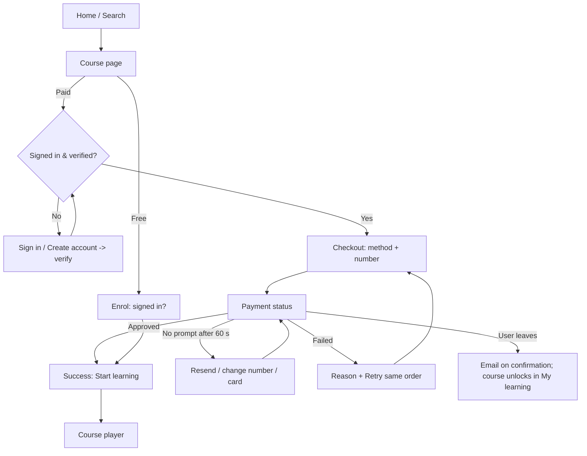

# 06 — UI/UX Design Blueprint: "Copperline"

> **Revision 4 (2026-10-11):** client approved tenancy decisions D1-D6: shared schema + forced RLS; no RLS-bypassing login role (NOLOGIN definer role + function inventory); global accounts with per-school memberships; sign-in on the school host and switching by one-time hand-off; Prisma + RLS go/no-go at 3 ms p95. D7 (legal controller role) remains open.
>
> **Revision 3 (2026-10-11):** S-AD09 regrouped (course and material defaults, capability-limited payment settings, languages); new S-AD19 Domain, S-AD20 Payment reconciliation, S-AD21 Billing; learner language switcher; per-language texts in the branding editor; "Platform fee" renamed "Commission" in S-T07.
>
> **Revision 2 (2026-10-11): multi-tenancy and white-label.** Copperline is now the **default theme and the structural design system** that every tenant shares. Tenants change identity tokens (logo, accent, font preset, terminology), never layout or components. "Admin" in this document means the **tenant admin space**. The separate **platform console** is specified in §10, together with theming rules, tenant admin screens S-AD11–S-AD18 and console screens S-C01–S-C09.

## 0. Current interface

**None exists** (VERIFIED, 02 §1), so there is no current UI to document. In its place, these are the interface patterns that common course platforms get wrong, which Copperline deliberately avoids:

| Common pattern | Problem for StudyHub's users | Copperline answer |
|---|---|---|
| Heavy hero banners and carousels on the catalogue | Slow on low-end phones and costly data; low information density | Text-first catalogue cards, one lazy cover image, no carousels |
| Course player with permanent sidebar and video autoplay | Unusable at 360 px; burns data | Outline in a bottom sheet (mobile) or side rail (desktop); click-to-play with low default quality in data-saver mode |
| Quiz inside the normal app chrome | Distraction; accidental navigation loses context | Full-screen **Focus mode** with a server-synced timer line and a navigator grid |
| Tutor tools as long forms with many tabs | Hard to see course structure | **Outline-first canvas**: structure is the page, details open in a side panel |
| Admin as generic CRUD tables | Staff can't see what needs action | **Queue-first** admin: work queues with counts and age, tables second |
| Payment as a single spinner | Users abandon or double-pay when the mobile-money prompt is slow | **Step-by-step payment status** with explicit "approve on your phone" guidance and recovery actions |

## 1. Product design strategy

### 1.1 Target users and needs
| User | Context (ASSUMED, validate in research Q-UX-1) | Top needs |
|---|---|---|
| **Learner** | Secondary, college or university student; mid or low-end Android phone; prepaid data; intermittent 3G/4G; studies in short sessions | Find the right course fast; pay easily with mobile money; resume exactly where they left off; quizzes that don't lose answers; clear feedback |
| **Tutor** | Teacher or subject expert; builds on a laptop, checks results on a phone; moderate technical confidence | Structure a course quickly; reuse questions; see who is struggling; know what they've earned |
| **Admin** | Operator staff; desktop | See what needs action; resolve payment problems confidently; complete audit trail |

### 1.2 Usability principles
1. **Content first, chrome last.** Navigation recedes inside learning content.
2. **Every byte earns its place.** Performance is a design constraint (budgets in §9).
3. **Always show position and next step.** Progress line, breadcrumbs in Studio, a "Next" action on every lesson.
4. **Never lose work.** Autosave everywhere, with visible save state ("Saved · 2 s ago" / "Offline — will sync").
5. **Honest money.** Price, what's included and the payment state are explicit. No dark patterns, no fake urgency.
6. **Calm assessment.** Focus mode, a predictable timer, an unanswered-question summary before submit.
7. **Queues before tables.** Staff screens lead with what needs a decision.

### 1.3 Visual direction and rationale
**Copperline** is warm paper, slate ink and one copper line. It reads like a well-made study notebook, not a dashboard.

- **Canvas:** warm off-white paper (`#F7F5F0`) and a deep slate dark theme (`#111416`). Long reading is comfortable and high contrast without harsh pure white.
- **One accent, used sparingly:** copper (`#A3471C` light / `#E98D5E` dark), a nod to the region's copper heritage (ASSUMED market; swappable by token if the client's branding differs, Q-BRAND-1). Copper marks **the primary action, the current position and progress**, nothing else.
- **Signature motif, "the line":** a 2–3 px copper line that carries progress and position. It is the course progress rail beside the outline, the current-lesson marker, the draining quiz timer line at the top of Focus mode, and the step line in checkout. It gives the product a recognisable identity without decorative images.
- **Flat, bordered surfaces** instead of shadows: crisp on low-DPI screens and cheap to render. Shadows appear only on floating layers (menus, dialogs, sheets).
- **Typography:** Atkinson Hyperlegible Next for UI and body (designed for legibility, distinct letterforms for 1/l/I and 0/O, which suits numbers and quiz answers), and **Literata** for long-form lesson reading (a screen-optimised serif). Two families, subset, `font-display: swap`.
- **Iconography:** Lucide outline icons at 1.5 px stroke, always paired with text labels in navigation.
- **Illustration:** none in the first release. Empty states use a short message, a single line glyph and an action.
- **Deliberately distinct** from the Quora "Study Desk" blueprint in the same folder (02 §2).

### 1.4 Information architecture

```
Public
├─ Home (search-first; categories; new and popular courses)
├─ Browse / Search results (filters)
├─ Course page /c/{slug}  (preview lessons playable)
├─ Tutor page /t/{slug}
├─ Become a tutor (marketing + Apply)
├─ Help, Terms, Privacy, Refund policy
└─ Auth: Sign in · Create account · Verify email · Forgot/Reset password

Learn (learner space)
├─ Home "My learning" (continue, courses, open quizzes, recent results)
├─ Course player /learn/{course}/{lesson}
│   ├─ Quiz intro → Focus mode runner → Result & review
│   └─ Practice setup → Practice session → Practice summary
├─ Checkout /checkout/{order} → Payment status → Success
├─ Purchases & receipts
├─ Notifications
└─ Account (profile, security & sessions, preferences/data saver, privacy)

Studio (tutor space)
├─ Studio home (courses, items needing attention: grading, reviews, processing videos)
├─ Course workspace /studio/{course}
│   ├─ Outline (canvas)  ├─ Details  ├─ Questions (bank)  ├─ Quizzes
│   ├─ Pricing & access  ├─ Publish (checklist)  ├─ Learners  ├─ Results & grading  └─ Analytics
├─ Earnings (balances, statement, payouts)
├─ Tutor profile & payout methods
└─ Application status (before approval)

Admin (tenant admin, per tenant site)
├─ Overview (queues + key metrics + onboarding checklist until complete)
├─ Queues: Instructor applications* · Course reviews · Payment exceptions · Refund requests · Support-access requests
├─ Users · Team & roles · Courses · Orders & payments · Earnings & payouts*
├─ Reports & exports · Categories · Audit log
└─ Organisation: Branding · Features · Settings · Languages · Domain · Payment account · Reconciliation · Usage & plan · Billing · Data export & offboarding
   (* only when the feature is enabled)

Console (platform realm, console.<platform-domain>; separate sign-in)
├─ Overview (tenant counts by status, provider health, alerts)
├─ Tenants → Tenant detail (metadata, domains, plan & overrides, lifecycle, support-access history)
├─ Plans · Staff · Support access · Global settings · Platform audit log · Provider health
```

### 1.5 Navigation model
- **Spaces:** Learn, Studio, Admin. A user with several roles switches with a **space switcher** (an account-menu segment on desktop, the top of the Account screen on mobile). Each space has its own navigation and its own copper "you are here" line.
- **Learner, compact:** bottom bar with 4 labelled destinations: **Home · Browse · Learning · Account**. Hidden inside the course player and Focus mode.
- **Learner, medium and expanded:** top bar (logo, search, Learning, notifications, avatar).
- **Studio and Admin, expanded:** left rail (icons + labels, collapsible to icons at medium) and a page header with breadcrumbs. Inside a course: a horizontal secondary nav (Outline, Details, Questions, Quizzes, Pricing, Publish, Learners, Results). On compact screens Studio is **review-oriented** (results, grading, earnings, simple edits). Full outline editing is supported but optimised for ≥600 px.
- **Global search** (`/` shortcut): catalogue for learners; courses, questions and learners in Studio; users and orders in Admin.

### 1.6 Device behaviour summary
| Size | Breakpoint | Behaviour |
|---|---|---|
| Compact | < 600 px | Single column; bottom nav (Learn); sheets instead of side panels; sticky primary action bar at the bottom |
| Medium | 600–1023 px | Two columns where useful (catalogue grid 2-up; player with toggleable outline); Studio rail collapsed to icons |
| Expanded | 1024–1439 px | Player outline rail (320 px) + content (max 720 px reading measure); Studio canvas + inspector panel (360 px) |
| Wide | ≥ 1440 px | Centred content, max container 1280 px; admin tables can show more columns |

### 1.7 Key improvements over typical course platforms
Resume-exactly continuity; mobile-money-native checkout with recovery; server-synced Focus mode; offline-tolerant answer saving; outline-first authoring with a live publish checklist; queue-first admin; data-saver mode across video, images and downloads.

## 2. Design system

### 2.1 Token naming
`--sh-{category}-{role}-{variant?}`, e.g. `--sh-color-bg-canvas`, `--sh-color-text-muted`, `--sh-space-4`, `--sh-radius-md`. Tailwind 4 `@theme` maps tokens to utilities (`bg-canvas`, `text-muted`, `border-strong`). Components use **semantic** tokens only, never raw hex.

### 2.2 Colour (semantic tokens)
Contrast ratios computed with the WCAG 2.x formula (VERIFIED by script, 2026-10-11). Text pairs need ≥4.5:1; UI components and focus need ≥3:1.

| Token | Light | Dark | Use | Contrast (light / dark) |
|---|---|---|---|---|
| `bg-canvas` | `#F7F5F0` | `#111416` | page | — |
| `bg-surface` | `#FFFFFF` | `#191D21` | cards, panels | — |
| `bg-sunken` / `bg-raised` | `#EFECE5` | `#21262B` | wells, table headers / raised in dark | — |
| `text-default` (ink) | `#1C2126` | `#ECE9E2` | body | 14.9 / 15.3 on canvas |
| `text-muted` | `#4A535C` | `#B7BCC1` | secondary text | 7.2 / 9.7 |
| `text-subtle` | `#636B73` | `#9199A0` | captions, placeholders | 5.0 / 6.4 (4.6 on sunken) |
| `border-default` | `#DAD5CB` | `#30373D` | dividers (decorative only) | — |
| `border-strong` | `#857E71` | `#6E777F` | input borders, checkbox outlines | 4.0 / 3.7 vs surface ✔ ≥3 |
| `accent` (copper) | `#A3471C` | `#E98D5E` | primary actions, links, progress line | 6.0 on surface / 6.8 |
| `accent-hover` | `#8A3B16` | `#F2A47C` | hover/pressed | — |
| `on-accent` | `#FFFFFF` | `#1A0E07` | text on accent buttons | 6.0 / 7.6 |
| `accent-soft` | `#F8E6DA` | `#3A2418` | selected rows, current lesson bg | accent on it 5.0 / 5.8 |
| `success` / `success-soft` | `#0E6A4E` / `#DDF1E8` | `#4DC69B` / `#12302A` | correct, paid, passed | 6.6 / 8.0; on soft 5.6 / 6.7 |
| `info` / `info-soft` | `#1D5DA6` / `#E0ECF9` | `#83B3F2` / `#152639` | neutral notices, links in prose | 6.6 / 7.8; on soft 5.5 / 7.1 |
| `warning` / `warning-soft` | `#7F5300` / `#FCEFCF` | `#E9B24A` / `#33280F` | time running out, pending | 6.7 / 8.8; on soft 5.9 / 7.5 |
| `danger` / `danger-soft` | `#B0261D` / `#FBE3E1` | `#F28C83` / `#3A1A18` | errors, incorrect, destructive | 6.7 / 7.2; on soft 5.5 / 6.6 |
| `focus-ring` | `#1D5DA6` | `#83B3F2` | 2 px ring + 2 px offset | 6.1 / 8.5 vs canvas |

Rules: colour is never the only signal (correct/incorrect also use an icon and text); copper is reserved for primary action, current position and progress; destructive actions use `danger`, never copper.

### 2.3 Typography
Base 16 px; scale ≈1.2 (compact) and ≈1.25 (expanded) via `clamp()`.

| Token | Size / line-height (compact → expanded) | Weight | Use |
|---|---|---|---|
| `display` | 30/36 → 40/48 | 700 | Home and marketing headings only |
| `h1` | 26/32 → 32/40 | 700 | Page titles |
| `h2` | 22/28 → 24/32 | 700 | Section titles |
| `h3` | 18/26 → 20/28 | 600 | Card and panel titles |
| `body-lg` (reading, Literata) | 18/30 | 400 | Lesson text, max measure 68ch |
| `body` | 16/24 | 400 | Default UI text |
| `body-sm` | 14/20 | 400 | Secondary text, table cells |
| `caption` | 13/18 | 500 | Meta, timestamps |
| `label` | 14/20 | 600 | Form labels, buttons |
| `mono` | 14/20 (JetBrains Mono, loaded only in code-bearing lessons) | 400 | Code |
Numbers in prices, timers and scores use tabular figures (`font-variant-numeric: tabular-nums`).

### 2.4 Spacing, layout, shape, elevation, motion
- **Spacing:** 4 px base: `space-1`=4, 2=8, 3=12, 4=16, 5=20, 6=24, 8=32, 10=40, 12=48, 16=64.
- **Gutters:** 16 px compact, 24 px medium, 32 px expanded. Containers: reading 720, app 1280.
- **Grid:** 4 columns compact, 8 medium, 12 expanded; 16/24 px gaps.
- **Radius:** `sm` 4 (inputs, chips), `md` 8 (buttons, cards), `lg` 12 (sheets, dialogs), `full` (avatars, badges).
- **Elevation:** `0` bordered surface (default); `1` menus and popovers (0 4 12 rgba(0,0,0,.12)); `2` dialogs and sheets (0 12 32 rgba(0,0,0,.18)). Dark mode uses lighter surfaces instead of stronger shadows.
- **Motion:** 120 ms (hover, press), 200 ms (sheets, panels), 280 ms (page-level); ease `cubic-bezier(.2,0,0,1)`. `prefers-reduced-motion` turns transitions off and the timer line steps every 10 s instead of animating.
- **Touch targets:** ≥44×44 px (WCAG 2.5.8 requires 24; Copperline uses 44 for learners).
- **Z-index tokens:** base 0, sticky 10, rail 20, overlay 40, sheet/dialog 50, toast 60.

### 2.5 Components (in `packages/ui`)
| Component | Variants and rules |
|---|---|
| **Button** | `primary` (copper, one per view region), `secondary` (bordered), `ghost`, `danger`; sizes `md` 44 px / `sm` 36 px (dense desktop only); loading state keeps the width and shows a spinner + "Saving…"; icon-only buttons need an `aria-label` and a tooltip |
| **Input / Textarea** | Label above (never placeholder-only); optional hint below; error message below with icon, linked by `aria-describedby`; 44 px height; `border-strong`; focus ring |
| **Phone input** | Country fixed to +260 (ASSUMED) with a network badge auto-detected from the prefix (MTN 096/076, Airtel 097/077, Zamtel 095/075 — verify current prefixes, Q-PAY-2), editable |
| **Money display** | `K250.00` via Intl; tabular numbers; "Free" instead of K0.00 |
| **Select / Combobox** | Radix Select for <10 options, Combobox with search for more |
| **Checkbox / Radio / Switch** | Large hit area including the label; quiz options use **Choice cards** (whole card selectable, letter badge A–D, keyboard 1–9) |
| **Dialog** | Confirmations and short forms only; focus trapped; Esc closes unless destructive work is in progress |
| **Sheet** | Bottom sheet (compact) or side sheet (expanded) for outline, filters and inspectors |
| **Tabs / Secondary nav** | Underline style with the copper line for the active item |
| **Table** | Sticky header, sortable headers (`aria-sort`), row actions in a menu, cursor pagination "Load more" (tables) or numbered pages for admin with totals; on compact screens tables become **stacked list rows** |
| **Card** | Course card (cover 16:9 lazy, title, tutor, level, duration, price); Stat card; Queue card (count, oldest age, CTA) |
| **Progress line** | Horizontal (course card, header) or vertical rail (outline); `role="progressbar"` with `aria-valuenow` and a text label ("6 of 14 lessons") |
| **Timer line** | Top 3 px bar + text "18:42 left"; turns `warning` at 5 min, `danger` at 1 min; screen-reader announcements at 10, 5 and 1 min only |
| **Navigator grid** | Question numbers; states: unanswered (outline), answered (filled ink), flagged (bookmark icon), current (copper ring) |
| **Alert / Banner** | info, success, warning, danger; inline (form-level) and page-level (offline, maintenance) |
| **Toast** | Non-blocking confirmations ≤6 s; actions (e.g. Undo) extend to 10 s; `role="status"`; never used for errors needing action |
| **Status badge** | Draft, In review, Published, Pending, Paid, Failed, Needs review… with icon + text; colour from semantic tokens |
| **Empty / Error / Permission-denied / Offline states** | Standard patterns (§2.6) |
| **Skeleton** | For lists and cards; shown only after 300 ms to avoid flashing |
| **Rich text renderer / editor** | Renderer: typographic styles for lesson content, KaTeX, callouts, code; Editor: Tiptap with a minimal toolbar, slash commands, image upload, maths block |
| **Media** | Video player (HLS, quality selector, speed, captions when available, "data saver" default 360p); PDF viewer (page thumbnails on expanded, swipe on compact); file row (icon, name, size, Download/Open) |
| **Stepper** | Checkout and tutor application; uses the line motif |
| **Save indicator** | "Saving…" / "Saved" / "Offline — will sync" / "Couldn't save · Retry" |

### 2.6 State patterns
| State | Pattern |
|---|---|
| Loading | Skeleton after 300 ms; buttons show inline spinners; never a full-page spinner after first load |
| Empty | Glyph + one sentence on why it's empty + one primary action ("You haven't enrolled in a course yet. **Browse courses**") |
| Error (recoverable) | Inline alert with plain-language cause + "Try again"; `requestId` under "Details" for support |
| Error (page) | "Something went wrong on our side" + Retry + Home; reported to Sentry automatically |
| Success | Toast for small actions; a dedicated screen for milestones (payment success, course completed, quiz submitted) |
| Disabled | 40% opacity is **not** used alone: disabled controls keep readable text (`text-subtle`) and explain why on hover or focus or in adjacent text ("Publish is available when the checklist is complete") |
| Permission denied | "You don't have access to this page" + who to contact or the action to gain access (e.g. Enrol/Buy for locked lessons) |
| Not found | Search box + links to Home and My learning |
| Offline | Top banner "You're offline. We'll sync when you're back." Actions that need a network are disabled with that explanation; Focus mode keeps working (§3 S-L07) |
| Processing (media) | Inline status with expected time; the page polls quietly |

### 2.7 Form validation and feedback
- Validate on **blur** and on submit; re-validate on change after the first error. Never validate while the user is still typing a field for the first time.
- On submit with errors: an error summary at the top (`role="alert"`) listing errors as links to the fields; focus moves to the summary.
- Server errors from `errors[]` map onto fields; anything unmapped goes in the summary.
- Messages say what to do: "Enter a Zambian mobile number, e.g. 097 123 4567", not "Invalid input".
- Long forms (course details, tutor application) autosave drafts; only the final submit validates completeness.
- Destructive actions: a confirmation dialog naming the object ("Delete lesson 'Cell membranes'?"); irreversible ones need typing the name only for courses with enrolments.

### 2.8 Accessibility requirements (WCAG 2.2 AA)
- Semantic landmarks (`header`, `nav`, `main`, `aside`, `footer`); one `h1` per page; logical heading order.
- Full keyboard operation; visible focus ring on every interactive element (`focus-visible`, 2 px `focus-ring` + 2 px offset); focus never obscured by sticky bars (WCAG 2.4.11), via `scroll-padding`.
- Skip link "Skip to content"; in the player also "Skip to lesson outline".
- Quiz runner keyboard: `1–9` select option, `F` flag, `N`/`P` next/previous, `Ctrl/Cmd+Enter` submit dialog. Shortcuts are listed in a help dialog and can be turned off (WCAG 2.1.4).
- Timed quizzes: **accommodations** — the tutor can grant extra time per learner (SHOULD, ×1.25/×1.5/×2) to satisfy WCAG 2.2.1 where timing is essential.
- Forms: labels, hints and errors programmatically associated; no placeholder-only labels; `autocomplete` attributes (email, name, tel, new-password).
- Media: captions support (WebVTT upload, SHOULD); transcripts as a lesson attachment; no autoplay.
- Images: tutor-supplied alt text required in the editor (it warns on missing alt).
- Maths: KaTeX output with MathML for screen readers.
- Colour contrast per §2.2; no information by colour alone.
- Dragging: every drag-and-drop (outline reorder) has a keyboard and button alternative ("Move up/down", "Move to section…") (WCAG 2.5.7).
- Target size ≥24 px everywhere, 44 px in learner flows.
- Respect `prefers-reduced-motion`, `prefers-color-scheme`, browser zoom to 200% and text spacing overrides without loss of content.

## 3. Screen-by-screen blueprint

Format: **Purpose · Role · Hierarchy (top → bottom) · Primary / secondary actions · Interactions · Validation and failure · Responsive · Accessibility**.

### Public and auth

**S-P01 Home** · Visitor/Learner · Learners land and immediately search or pick a category.
Hierarchy: search field (largest element, "What do you want to learn?") → category chips (horizontal scroll) → "Continue learning" strip (signed-in only) → New courses → Popular this month → "Teach on StudyHub" band.
Actions: search (primary); category; course card. Responsive: compact single column with 1.2-card horizontal scroll per shelf; expanded 4-column grid. A11y: search has a visible label; shelves are `section`s with headings; scroll shelves have arrow buttons and are keyboard-reachable.

**S-P02 Browse / Search results** · Visitor/Learner.
Hierarchy: query + result count → active filter chips (removable) → result list → load more.
Actions: Filter (opens a sheet on compact, persistent left column on expanded): subject, level, price (Free/Paid), language, length; Sort. Filters live in the URL.
Failure: no results → suggestions (spelling, remove filters, popular in category). Search errors → inline retry.
A11y: the results count is announced (`aria-live="polite"`) after filtering.

**S-P03 Course page** · Visitor/Learner · Decide to enrol or buy.
Hierarchy: title, subtitle, tutor, level, total duration, lesson and quiz counts → **sticky action card** (price, primary CTA: "Enrol for free" / "Buy for K250.00" / "Continue learning"; secondary: "Preview lessons") → What you'll learn → Outline (sections collapsible; preview lessons marked "Preview" and playable in a sheet) → Requirements → Description → About the tutor → Refund policy summary.
Responsive: compact has a bottom sticky bar with price + CTA; expanded has a right sticky card.
States: already enrolled → "Continue — Lesson 6"; pending order → "Complete your purchase"; course unpublished → 404 for visitors, a banner for enrolled learners.
A11y: the CTA label includes the price as text; outline sections are buttons with `aria-expanded`.

**S-P04 Tutor page** · Visitor · Trust and discovery: photo, name, headline, subjects, bio, courses grid.

**S-P05 Become a tutor** · Visitor/Learner · Explains how it works (apply → review → build → publish → get paid), the revenue share (from settings), CTA "Apply" (sign-in or verify gate).

**S-A01 Sign in** · Email, password (show/hide), "Forgot password?", "Create account". Errors: generic "Email or password is incorrect"; lockout message with the time remaining. A11y: errors in the summary + focus.
*Rev. 4:* one account works across schools, so the helper text says "Use your account email and password" (neutral, BR-71). A wrong password, an unknown email and "not a member of this school" all show the same message (BR-65). If the person has an account but no membership and the school allows open registration, after sign-in they see **Join *School*** (S-A06).
**S-A02 Create account** · Name, email, password (strength meter + breached-password message), terms checkbox (links). After submit → **S-A03 Check your email** (address shown, "Resend" with cooldown countdown, "Change email").
**S-A04 Verify result** · Success → continue to where the user was heading (stored `returnTo`); expired → resend.
**S-A05 Forgot / Reset password** · Generic confirmation; reset form with the password rules; success → sign in.

### Learn space

**S-L01 My learning (Home)** · Learner · Get back to studying in one tap.
Hierarchy: **Continue card** (course, lesson title, progress line, "Resume") → Open quizzes with deadlines (sorted by closing time) → My courses (progress line each; filter In progress / Completed) → Recent results.
Empty: no enrolments → "Find your first course" + 4 popular free courses.
Responsive: compact stacked; expanded 2 columns (courses left, quizzes and results right).

**S-L02 Course player — lesson** · Enrolled learner · Study the content.
Hierarchy: slim top bar (back to course, course title truncated, progress line along the bar's bottom edge, outline button) → lesson title → content by type (§F10) → attachments → **bottom action bar**: "Mark complete" (TEXT) / auto-complete indicator (VIDEO) → "Next: {lesson title}".
Outline: vertical progress rail with lesson states (✓ complete, ● current in copper, ○ not started, 🔒 locked for preview visitors); quiz lessons show a best score.
Interactions: keyboard `←/→` previous/next lesson (when focus is not in content); video resumes from the saved position; text lessons remember scroll position.
Data saver: video defaults to 360p; images load on tap; "Download for offline" hidden unless the tutor allows downloads.
Failure: lesson content failed → retry; access revoked → explanation + support; video still processing → tutor-only message.
Responsive: compact has the outline as a full-height bottom sheet; expanded has a persistent 320 px rail, collapsible.
A11y: the outline is a `nav` with `aria-current="page"`; completion is announced via a live region.

**S-L03 Course completed** · A completion moment: summary (lessons, quizzes passed, time spent), "Practise more", "Browse related", certificate placeholder (LATER).

**S-L04 Quiz intro** · Enrolled learner · Know the rules before starting.
Hierarchy: quiz title → rule list (questions, time limit, attempts used/allowed, pass mark, when results are shown) → availability (opens/closes) → previous attempts (score, date, review link) → primary "Start attempt" / "Resume attempt (14:10 left)".
States: not open yet (countdown, disabled with reason); closed; limit reached; offline → Start disabled ("Connect to start; you can keep answering if your connection drops later").
Confirmation dialog on Start for timed quizzes: "The timer starts now and keeps running if you leave."

**S-L05 Focus mode (quiz runner)** · Learner · Answer questions without distraction.
Layout: no app chrome. Top: timer line (draining copper, then warning or danger) + "18:42 left" + save indicator + "Questions" (opens the navigator) + Exit (returns to intro; the attempt continues). Centre: "Question 4 of 20 · 2 points", stem (Literata), answer area (choice cards / text input / numeric with unit hint / long-answer textarea with word count). Bottom bar: Previous · Flag · Next (on the last question "Review & submit").
Navigator: grid of numbers with states; filter "Unanswered / Flagged".
Review & submit sheet: counts (answered, unanswered, flagged) with links → "Submit attempt" (danger-free primary with a confirmation).
Offline: banner; answers queued (badge "3 unsynced"); submit while offline queues and finalises on reconnect, and the server accepts up to the deadline + grace.
Time expiry: at 0 a modal "Time's up — submitting your answers" → result screen (submitted server-side regardless).
Failure: save failure after 3 retries → persistent warning "Answers not saved — check connection"; the attempt is never discarded.
A11y: question is an `h2`; options are a radio group or checkbox group with letters; the timer announces at milestones only; all controls reachable without a pointer.

**S-L06 Result and review** · Learner (own), Tutor (course), Admin.
Hierarchy: score (big, tabular), percent, pass/fail badge (icon + text), time taken, attempt n of N → actions: "Review answers" (if the policy allows), "Try again" (if attempts remain), "Back to course" → per-question review: your answer, correct answer (policy), explanation, points.
States: `NEEDS_REVIEW` → "Some answers are being marked by your tutor"; policy `AFTER_CLOSE` → "Review opens on 12 Oct, 18:00".

**S-L07 Practice setup → session → summary** · Enrolled learner.
Setup: number of questions (5/10/20), topics (tags as chips), difficulty, "Only my mistakes" toggle → Start. Session: same runner component as S-L05 **without** the timer, with **immediate feedback** after "Check": correct (success icon + text) or incorrect (shows the correct answer + explanation) → Next. Summary: score, weak topics (tags with lowest accuracy), "Practise these again".

**S-L08 Checkout** · Learner · Pay for a course.
Stepper line: 1 Review → 2 Pay → 3 Confirm.
Hierarchy: order summary (course, tutor, price, access duration, refund policy link) → payment method segmented control: **Mobile money** (default) | **Card** → mobile money: phone input with network badge (pre-filled from profile) → primary "Pay K250.00" → small print "You'll get a prompt on your phone to approve".
Validation: number format and network; email verified (else an inline verify prompt with resend).
Failure: provider unavailable → "Payments are temporarily unavailable. Try again in a few minutes" + method switch suggestion.

**S-L09 Payment status** · Learner.
Mobile money states: "Check your phone — approve K250.00 with your PIN" (animated line, no spinner-only) → after 60 s: "Didn't get a prompt?" with **Resend prompt** / **Use a different number** / **Pay by card** → success → S-L10; failure: plain reason mapped from the provider code ("Insufficient balance", "Request declined", "Timed out") + Retry. Card: "Confirming your payment…" after return.
The learner can leave: "You can close this page — we'll email you and unlock the course as soon as the payment is confirmed."

**S-L10 Payment success** · "You're enrolled" + receipt number + "Start learning" (primary) + "Download receipt".

**S-L11 Purchases & receipts** · List (date, course, amount, status badge) → receipt view/download; "Request refund" (SHOULD) within the window.

**S-L12 Notifications** · List grouped by day; unread dot; mark all read; each item links to its object.

**S-L13 Account** · Sections: Profile (name, avatar, phone) · Sign-in & security (email change, password, sessions list with "Sign out" per device, 2FA for admins) · Preferences (theme, data saver, email notifications) · Privacy (download data, delete account with consequences listed and 30-day grace). Space switcher at the top for multi-role users.
*Rev. 4:* the page separates **Your account** (global: email, password, 2FA, "Sign out everywhere", delete account; changes apply to every school, which the page says) from **This school** (school-specific display name and student number, roles shown read-only, **Leave this school**).

**S-A06 Join school** (rev. 4) · Shown after signing in with an existing account on a school where the person has no membership and registration is open: school name and logo, what joining means (the school sees your name and email and your activity there; it can't see your other schools), primary **Join *School***, secondary "Not now" (signs out of this school). Invite-only schools show "Ask the school for an invitation" instead.

### Studio space (tutor)

**S-T01 Tutor application** (pre-approval) · Stepper: About you → Subjects & experience → Payout details → Agreement → Submit. Autosaved. Status page afterwards: Submitted / Changes requested (with admin note, "Edit application") / Approved ("Create your first course") / Rejected (reason, reapply date).

**S-T02 Studio home** · Tutor · What needs attention, then my courses.
Hierarchy: attention list (answers to grade: n, course feedback from review, videos processing, courses failing checklist) → courses table/cards (title, status badge, learners, revenue this month, last edited) → "New course".
Empty: "Create your first course" with a 3-step explainer.

**S-T03 Course workspace — Outline (canvas)** · Owner.
Layout (expanded): left = outline canvas (sections as groups, lessons as rows with type icon, preview/required badges and a status dot: ready, incomplete, processing); right = **inspector** panel for the selected lesson (title, type-specific editor: rich text, video upload/status, files, quiz picker; flags preview/required/downloadable). Top: course title, status badge, save indicator, "Preview as learner", "Publish" (shows the checklist count "3 items left").
Interactions: add section/lesson inline (Enter to add the next); drag to reorder with the keyboard alternative; multi-select move; duplicate; delete with undo toast (10 s).
Compact: outline list → tap a lesson → full-screen editor.
Failure: version conflict → banner with Reload; upload failure → row-level retry.

**S-T04 Course details** · Title, subtitle, description (editor), outcomes (list builder), requirements, level, language, subject, tags, cover image (crop to 16:9 with focal point). Live **preview card** showing how it looks in the catalogue.

**S-T05 Question bank** · Owner.
Table/list: stem excerpt, type, difficulty, tags, used in n quizzes, practice-eligible toggle. Filters, search, bulk tag, archive. "New question" opens an editor sheet: type selector → stem → options (add/reorder, mark correct) or accepted answers/numeric value + tolerance → points, difficulty, tags, explanation → "Save & add another". Inline validation (e.g. "Mark one correct answer"). "Import CSV" (SHOULD): upload → dry-run report (rows OK / errors with line numbers) → confirm.

**S-T06 Quiz builder** · Owner.
Two panes: left = settings (time, attempts, pass mark, availability, shuffle, feedback policy); right = question list (add from bank via a searchable picker with filters, reorder, points override) or draw rules (SHOULD). Header shows total points and the estimated time. Warning when the quiz has attempts (BR-23). "Preview" runs the quiz in Focus mode without recording.

**S-T07 Pricing & access** · Free/Paid toggle, price input (K, minimum shown), sale price + end date (SHOULD), access duration (lifetime / n days), payout-method check ("Add a payout method to sell this course"), earnings preview: "Learner pays K250.00 · Commission K50.00 · You earn ≈ K200.00" (instructor commission from the tenant's settings, shown only with revenue share; provider fee noted as variable).

**S-T08 Publish** · The checklist as a list of items with ✓/✗ and "Fix" links; the submit button is enabled when all pass; review notice ("Our team reviews new courses, usually within 2 working days" — copy depends on Q-BIZ-3); after submission shows the status and admin notes (changes requested).

**S-T09 Learners** · Table: learner, enrolled date, progress line, last active, quiz average; filter (not started / in progress / completed); row → learner detail in this course (lesson progress, attempts). Export CSV. Privacy: learner email visible only if Q-PRIV-2 allows; display name by default.

**S-T10 Results & grading** · Tabs: Attempts (filter by quiz, status) · **Grading queue** (one answer at a time: question, model answer/notes, learner response, points input 0–max, comment, "Save & next"; progress "4 of 17") · Analytics (SHOULD: score distribution histogram, per-question % correct and option pick rates, flagged "possibly misleading" questions where top-scorers fail).

**S-T11 Earnings** · Balance cards (Pending · Available · Paid this year) → statement table by month (sale, refund reversal, adjustment; gross, fees, net) → payouts history → CSV export. Explainer of when money becomes available.

**S-T12 Tutor profile & payout methods** · Public profile editor with a live preview; payout methods (masked), set default.

### Admin space

**S-AD01 Overview** · Admin · **Queue cards first** (Tutor applications n · oldest 2 d; Course reviews; Payment exceptions; Refund requests) → key metrics for the range (revenue gross/net, new learners, enrolments, payment success rate by method) → alerts (ledger mismatch, provider errors).

**S-AD02 Queue screens** (applications, course reviews, payment exceptions, refunds) · A shared **review layout**: list on the left (age, name, flags), detail on the right; decision bar at the bottom (Approve / Request changes / Reject with a required note). Course review detail shows the checklist snapshot, a link to "Preview as learner", outline and sample lessons. Payment exception detail shows the order snapshot vs provider amounts, the event timeline (raw events collapsible) and actions: Re-check with provider · Accept and grant access · Refund. Keyboard: `J/K` next/previous item.

**S-AD03 Users** · Search (name/email/phone) → user detail tabs: Overview (status, roles, verification), Enrolments (grant/revoke with reason), Orders, Sessions (revoke), Audit trail for this user. Dangerous actions (suspend, role change) use confirmation dialogs with a reason field.

**S-AD04 Orders & payments** · Filterable table (date range, status, method, network, course, tutor) → order detail: timeline (created → payment initiated → events → confirmed → receipt → refund), ledger lines, actions (refund with Idempotency-Key, resend receipt, re-check).

**S-AD05 Earnings & payouts** · Tutors with available balances → payout run: select entries → total → enter external reference and date → record payout (confirmation) → tutor notified.

**S-AD06 Courses** · All courses with status filters; unpublish with reason; view as learner.
**S-AD07 Reports & exports** · Date range, charts (revenue, enrolments, payment success), export buttons with async status.
**S-AD08 Categories** · Tree editor with reorder and archive.
**S-AD09 Settings** · Grouped forms (Commerce: fee, minimum price, order expiry, refund window; Moderation: course review required; Uploads; Maintenance banner). Each change asks for a reason and shows the last change by whom.
**S-AD10 Audit log** · Filter by actor, action, entity, date; row expands to a before/after diff.

### System screens
**S-X01 404**, **S-X02 Error**, **S-X03 Offline fallback** (PWA), **S-X04 Maintenance**, **S-X05 Permission denied** — using the patterns in §2.6.

## 4. Major interaction flows

### 4.1 Discover → buy → learn

Proceed: payment confirmed by the server. Cancel: "Cancel order" on checkout (no money taken). Recover: retry on the same order until expiry; after expiry a new order is created automatically. A late success is still honoured.

### 4.2 Timed quiz
Intro → Start (confirm) → Focus mode (autosave; offline queue) → Review & submit (unanswered summary) → Result. Exit returns to the intro with "Resume". Time-out auto-submits. Re-entry from any device resumes. No cancel of a started assessed attempt (rule stated on the intro).

### 4.3 Tutor: application → first published course
Apply (autosaved stepper) → Submitted → (Changes requested ↺) → Approved → New course (title + subject) → Outline canvas → Details → Questions/Quizzes → Pricing → Publish checklist → In review → (Changes requested ↺) → Published. At any point the tutor can leave; everything autosaves.

### 4.4 Admin: payment exception
Overview queue card → exception detail (amount mismatch / late success / duplicate) → Re-check with provider → decide: Accept (grants access, audited) or Refund (provider or manual) → learner and tutor notified → item leaves the queue.

## 5. Microcopy principles
Plain English at about a Grade 8 reading level; second person; specific numbers ("2 attempts left", "K250.00"); errors explain what happened and what to do; no blame ("We couldn't reach MTN" rather than "You failed to…"); currency always with the "K" symbol and 2 decimals; dates "12 Oct 2026, 18:00".

## 6. UX quality criteria (testable)

| # | Criterion | How tested |
|---|---|---|
| UX-01 | A first-time learner finds and opens a relevant course in ≤60 s (median) | Moderated usability test, 5–8 participants (Q-UX-1) |
| UX-02 | ≥90% of test participants complete a mobile-money purchase without help | Usability test against a provider sandbox |
| UX-03 | Resume: "Continue" lands on the exact lesson and video position (±5 s) | Playwright e2e across two browser contexts |
| UX-04 | No quiz answer is lost when the network drops for 60 s mid-attempt | Playwright with offline emulation |
| UX-05 | Every async action shows feedback within 100 ms (pressed state) and progress within 300 ms | Component tests + manual review |
| UX-06 | All pages pass axe with 0 serious or critical violations | Playwright + axe in CI |
| UX-07 | Full keyboard completion of: sign-up, purchase, quiz attempt, lesson authoring, admin approval | Scripted keyboard-only e2e + manual screen-reader pass (NVDA + TalkBack) before release |
| UX-08 | Layout works with no horizontal scroll at 320 px width and at 200% zoom | Visual regression at 320/375/768/1024/1440 |
| UX-09 | Colour tokens meet §2.2 ratios in both themes | Token contrast test in CI (script in `packages/ui`) |
| UX-10 | Performance budgets met (§9) | Lighthouse CI on catalogue, course page, player, quiz runner |
| UX-11 | Copper accent is used for at most one primary action per view region | Design review checklist; Storybook stories |
| UX-12 | Every empty, error and permission state uses the standard pattern with an action | Storybook coverage list per screen |
| UX-13 | Tutor publishes a 5-lesson course with 1 quiz in ≤30 min on first use | Usability test with 3–5 tutors |

## 7. Responsive specification (summary)
See §1.6. Additional rules: sticky bottom action bars on compact for primary flows (course page CTA, player Next, checkout Pay, quiz navigation); sheets replace side panels below 1024 px; tables become stacked lists below 600 px; reading measure never exceeds 72 ch.

## 8. Localisation
All copy in message catalogs; no text in images; layouts tolerate +35% string length; numbers, currency and dates via `Intl`; time zone shown when deadlines are displayed ("closes 18:00 CAT").

## 9. Performance budgets (design-relevant)
| Page | LCP (p75, Slow 4G, mid-range Android) | JS (compressed, route) | Images |
|---|---|---|---|
| Home / Browse / Course page | ≤2.5 s | ≤120 KB | Covers ≤40 KB each (AVIF/WebP, responsive sizes), lazy below the fold |
| Course player (text lesson) | ≤2.5 s | ≤170 KB | Lesson images lazy; tap-to-load in data saver |
| Quiz runner | Interactive ≤3 s | ≤150 KB | — |
| Studio outline | ≤3.5 s (desktop broadband) | ≤350 KB (editor lazy) | — |
Fonts: ≤4 WOFF2 files, Latin subset, ≤120 KB total; preloaded only for UI regular and bold.

## 10. White-label theming, tenant administration and platform console (revision 2)

### 10.1 What tenants can and can't change

| Tenants can change (identity) | Tenants can't change (structure, quality) |
|---|---|
| Display name, logos (light and dark), favicon and app icon | Layout, navigation model, component shapes, spacing, type scale |
| **Accent colour** (replaces copper in `accent`, `accent-hover`, `accent-soft`, `on-accent` and the progress and timer line) | Semantic colours (success, warning, danger, info), neutrals, focus ring |
| Font preset: Copperline (Atkinson Hyperlegible Next + Literata), Humanist, Geometric (each a self-hosted pair) | Arbitrary fonts or CSS |
| Home page sections and order, hero text, featured courses | Accessibility behaviour, state patterns, performance budgets |
| Terminology (Instructor/Tutor/Teacher/Lecturer; Course/Module/Subject) | Microcopy structure (only the terms are substituted) |
| Footer links, support contacts, legal pages | "Powered by" badge only if the plan has `whiteLabel` |

**Accent rules (BR-51):**
- The theme compiler works in OKLCH.
- For the light theme it lowers lightness until accent text on canvas and surface is ≥4.5:1 and `on-accent` on accent is ≥4.5:1.
- For the dark theme it raises lightness to meet the same ratios on the dark canvas and surface.
- If chroma clipping makes either impossible, the colour is rejected, and the editor shows the nearest 3 compliant suggestions.
- The default copper values (§2.2) are the reference output of this compiler. A test asserts they compile unchanged.

### 10.2 Tenant admin screens (additions)

**S-AD11 Onboarding checklist** (overview card until done) · Tenant owner · Steps: Brand your site → Set policies (terms, privacy, refunds) → Connect payment account (skip if free-only) → Invite instructors → Create or approve the first course → Go live. Each step shows done or to-do with a deep link. "Go live" is enabled when the required steps are done (activation needs the operator if the platform keeps that control, Q-TEN-10).

**S-AD12 Branding editor** · Owner/Admin.
- Layout (expanded): left = form sections (Identity, Colour, Typography, Home page, Footer and contacts, Terminology, Email sender), with a **language tab strip** for every text field when more than one language is enabled (missing translations are flagged and fall back to the default language); right = **live preview** frame with a device toggle (phone, desktop) and a theme toggle (light, dark), previewing the home page, course page, quiz runner and an email.
- Colour picker shows the computed contrast ratios and a pass or fail result for each pair. A rejected colour shows suggestions.
- Actions: Save draft (autosave), **Publish** (confirmation shows a before/after preview), Version history with Restore.
- Compact: form only, with a "Preview" sheet.
- Failure: logo too large or wrong type → field error; SVG is rejected or sanitised (Q-TEN-13).

**S-AD13 Features** · Owner/Admin · List of features with a description, plan status ("Included" / "Not in your plan — contact us") and a switch. Turning a feature off shows the consequence ("Practice will be hidden from learners. Practice history is kept.") and needs confirmation.

**S-AD14 Team & roles** · Owner/Admin · Members table (name, email, roles, last active, status), pending invitations (resend, revoke), "Invite people" dialog (emails, role, optional message), bulk CSV invite (SHOULD), and an ownership transfer flow (owners only; the new owner must accept).

**S-AD15 Payment account** · Owner.
- Empty state explains why it's needed (to sell courses) and what's required (a merchant account with the supported provider).
- Connect form: credentials fields are write-only. Once saved they display as a masked hint and can be replaced, never viewed.
- **Test connection** shows the result and which methods were detected (mobile money networks, card); Activate follows.
- Status badges; a warning when paid courses exist but the account is disabled.

**S-AD16 Support access** · Owner/Admin · Requests (staff name, reason, scope, requested duration) with Approve or Deny; active grants with a countdown and Revoke; history with a link to the audit entries for each grant.

**S-AD17 Usage & plan** · Owner/Admin · Usage meters against limits (active learners, instructors, storage, video minutes) with 80% and 100% states; daily trend chart; plan features; "Request a plan change" (a message to the platform, since billing is manual at first).

**S-AD18 Data export & offboarding** · Owner · Request a full export (status, download link that expires in 7 days); offboarding request with consequences, the 30-day grace explanation and cancel during grace; type-to-confirm with the tenant name.

**S-AD09 Settings (revision 3):** grouped as:
- **Learners:** registration mode, allowed email domains, unverified free enrolment.
- **Catalogue:** visibility.
- **Instructors:** onboarding mode, course review required.
- **Courses & materials:** allowed upload types (checkboxes limited to the platform allowlist), maximum document and video size (sliders capped by the plan, with the cap shown), downloads allowed by default, video completion threshold, default course access, quiz defaults, practice defaults. A note says that changes apply to new content only (BR-64).
- **Payments**, only after a payment account is active. Methods appear as switches **only for capabilities the account reported**; unsupported ones are shown disabled with "Not supported by your payment provider" (BR-62). Also: minimum price, order expiry, refund window, refund mode (provider or manual), instructor commission and payout schedule (only with revenue share), receipt seller details.
- **Languages & region:** default language, enabled languages (from the platform list, only English at launch, with a note that more are coming), time zone; currency read-only.
- **Legal pages:** per enabled language.

**S-AD19 Domain** (revision 3) · Owner · Shows the current address (`acme.<platform-domain>`) with copy and open buttons, and "Request a different address" (slug field with live availability and reserved-word checks, plus a reason). Pending requests show their status. The custom-domain section appears only when the `customDomain` feature is enabled: add a domain → DNS instructions (CNAME + TXT token) → Verify (status polling) → set as primary → remove. Errors in plain language ("We can't see the TXT record yet. DNS changes can take up to 24 hours.").

**S-AD20 Payment reconciliation** (revision 3, SHOULD) · Admin/Owner · Pick a date range → "Fetch from provider" (if a list API exists) or "Upload statement CSV" (template link) → summary (matched, missing in StudyHub, missing at provider, amount mismatches) → a mismatch list with actions (re-check with provider, accept, start refund, add note) → export the report.

**S-AD21 Billing** (revision 3) · Owner · Monthly platform statements (period, subscription, sales, refunds, platform commission, total due, status), each with a detail view and PDF. Read-only, plus a "Questions about this statement?" contact link.

**Learner language switcher** (revision 3) · In the account menu and footer, shown only when the tenant has more than one enabled language. Changes the UI language immediately and saves the preference (BR-61).

**School switcher** (revision 4) · In the account menu, shown only when the person has more than one ACTIVE membership: lists their schools (logo, name, roles), current one marked. Choosing another school opens it already signed in through a one-time hand-off (BR-68); a short "Opening *School*…" state covers the redirect. If the hand-off fails (expired, membership changed) the target school shows its normal sign-in with an explanation. The switcher never appears in the platform console.

### 10.3 Platform console screens

The console uses the same Copperline components with a **fixed console theme** that uses the info blue (`#1D5DA6` light / `#83B3F2` dark) as its accent, never copper or tenant branding. A permanent top strip reads "Platform console", so staff never confuse it with a tenant site.

| Screen | Purpose and key content |
|---|---|
| **S-C01 Console sign-in + TOTP** | Email, password, then a 6-digit code; TOTP enrolment on first sign-in; no "create account" |
| **S-C02 Overview** | Tenants by status, new this month, provider health (payments, video, email), alert list, tenants near limits |
| **S-C03 Tenants list** | Search, filters (status, plan, kind), columns: name, slug or host, status, plan, active learners, storage %, created. **No personal data** |
| **S-C04 Tenant detail** | Tabs: Overview (metadata, owner contact as entered at provisioning), Domains, Plan & overrides, Usage, Lifecycle (activate, suspend, offboard, each with a reason dialog), Support access (history; "Request access"; emergency for owners) |
| **S-C05 Create tenant** | Stepper: Organisation → Address (slug with live availability and the reserved check) → Plan → Owner invitation → Review |
| **S-C06 Plans** | Plan list and editor (features, limits); changing a plan shows the affected tenants count |
| **S-C07 Staff** | Platform staff, roles, 2FA status, deactivate |
| **S-C08 Global settings & provider health** | Global settings with a reason per change; provider status and recent errors |
| **S-C09 Platform audit log** | Filters by actor, tenant, action; diff view |

### 10.4 System and support screens (additions)
- **S-X06 Site not found:** neutral, platform-branded only by default, no tenant hints (BR-60).
- **S-X07 Tenant unavailable (suspended):** tenant-branded, neutral wording ("This site is temporarily unavailable"). Signed-in learners see a link to their purchased content (read-only, BR-52).
- **S-X08 Coming soon (provisioning):** tenant name only, with a sign-in link for invited owners.
- **Support session banner:** a full-width warning strip on every page: "Support access by {staff name} · read-only · ends 14:32 · actions are logged", with an "End session" button. It can't be dismissed.

### 10.5 Additional UX criteria

| # | Criterion | How tested |
|---|---|---|
| UX-14 | A tenant owner completes branding (logo, colour, home page) and publishes in ≤10 min on first use | Usability test with 3 school admins |
| UX-15 | No branded tenant page or email shows another tenant's name, logo or colour | Cache-isolation e2e (04 §17.13) + email snapshot tests |
| UX-16 | Every accent colour accepted by the compiler meets BR-51 in both themes | Property test: 10,000 random colours → accepted ones always pass contrast |
| UX-17 | Console and tenant admin are visually distinct enough that staff identify the realm in under 2 s | First-click and identification test with 3 users |
