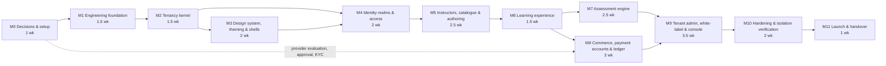

# 07 — Implementation Roadmap

> **Revision 4 (2026-10-11):** client approved tenancy decisions D1-D6: shared schema + forced RLS; no RLS-bypassing login role (NOLOGIN definer role + function inventory); global accounts with per-school memberships; sign-in on the school host and switching by one-time hand-off; Prisma + RLS go/no-go (D5 revised by the client after measurement: exactly one extra statement per transaction and <0.5 ms database time). D7 (legal controller role) remains open.
>
> **Revision 3 (2026-10-11).** Revision 2's M1 combined tooling with the tenancy kernel, so it depended on an unanswered critical decision (Q-TEN-3) and on staging decisions (Q-TEN-6, Q-OPS-2). It is now split:
> - **M1 Engineering foundation:** needs no open decision except where the repository lives (Q-REPO-1).
> - **M2 Tenancy kernel:** starts once Q-TEN-3 is answered.
>
> All later milestones move up by one (M0–M11). Tenancy still comes **before any product feature**, which avoids the rework described in 10 §9. Revision 3 scope (languages, domain settings, course and material settings, payment capabilities, settlement reconciliation, platform statements) is placed in M3, M5, M8 and M9.
>
> **Revision 2** wove multi-tenancy into every milestone and corrected revision 1's arithmetic (it said ≈18 weeks, but its durations summed to 19).

Estimates assume **one experienced full-stack developer with AI assistance** (ASSUMED, Q-OPS-3). Durations are effort weeks. Payment-provider evaluation runs in parallel from M0. **No real provider is integrated without client approval** (Q-PAY-3).

## 1. Milestone overview

| Milestone | Effort (weeks) |
|---|---|
| M0 | 1 |
| M1 | 1.5 |
| M2 | 1.5 |
| M3 | 2 |
| M4 | 2 |
| M5 | 2.5 |
| M6 | 1.5 |
| M7 | 2.5 |
| M8 | 3 |
| M9 | 3.5 |
| M10 | 2 |
| M11 | 1 |
| **Total** | **24** (range 20–28) |

M7 and M8 can run in either order after M6. Do M8 first if an approved provider sandbox is ready.

## 2. Milestones

**Every DoD includes:**
- Required CI gates green (§4).
- From M2 onward, the isolation suite extended to the milestone's new tables and endpoints.
- Docs and ADRs updated.
- A local demo.
- An honest status report.

### M0 — Decisions and setup
- **Scope:**
  - Answer Q-REPO-1 (needed for M1) and Q-TEN-3 (needed for M2).
  - Start the long-lead items: payment-provider evaluation against 10 §11 (no selection without approval), merchant KYC for the first selling tenant, legal review (Q-LEG-1/4).
  - Choose the platform domain and hosting region (needed to finish M2 staging).
  - Prepare the development machine (10 §4).
- **DoD:** Q-REPO-1 answered; the other Tier A items are answered or scheduled with owners and dates.

### M1 — Engineering foundation (decision-free)
- **Goal:** a buildable, testable, CI-checked TypeScript monorepo with an API, a worker and a web app skeleton. **No tenancy, no users, no product features, no deployment.**
- **Scope:**
  - pnpm + Turborepo monorepo; strict TypeScript; ESLint, Prettier, dependency-cruiser; gitleaks.
  - `packages/contracts`: error codes, problem+json schema, health schema, OpenAPI generation.
  - `apps/api`: NestJS on Fastify, Zod-validated config, pino with redaction, request ids, problem+json filter, `/healthz` and `/readyz`.
  - Prisma migration pipeline with a migrator role and an app role; first migration creates one global table (`platform_setting`).
  - `apps/api` worker entry with pg-boss and a no-op heartbeat job.
  - `apps/web`: Next.js skeleton with a status page reading the API's readiness through the dev proxy.
  - Docker Compose with Postgres 17; Vitest, Testcontainers and Playwright wired up; GitHub Actions CI.
  - Blueprint copied into `docs/blueprint`; ADR template + ADR-001/002/003/014; README; local-dev runbook.
- **Exact files, tests, acceptance criteria and commands:** 10 §6–§8.

### M2 — Tenancy kernel
- **Prerequisite:** Q-TEN-3 answered. Staging at the end also needs Q-TEN-6 and Q-OPS-2; without them staging is reported as pending.
- **Scope:**
  - NOLOGIN role `studyhub_rls_definer` + SECURITY DEFINER inventory (`resolve_tenant`, `claim_due_outbox`) + role-posture checks (04 §17.4, rev. 4); `pnpm db:provision-roles` for existing local volumes.
  - `tenant` and `tenant_domain` tables; `resolve_tenant(host)`; TenantResolver hook; tenant context in AsyncLocalStorage.
  - Tenant-scoped Prisma extension; RLS policy helper; RLS coverage check.
  - First tenant-owned tables (`audit_log`, `outbox`) with forced RLS and composite keys.
  - Outbox with `outbox.claim` as the first named system job; job envelope requiring `tenantId`.
  - Next.js host-rewrite middleware (`/_t/[host]`); Caddy with `*.localhost` and internal TLS.
  - Seed of two mirrored tenants; `tenant:create` CLI.
  - Staging with a wildcard subdomain (if decided); Prisma + RLS micro-benchmark.
- **Tests and AC:**
  1. Two hosts resolve to two tenants; an unknown host returns a generic 404.
  2. Spoofed `X-Forwarded-Host` from an untrusted address is ignored.
  3. RLS coverage check, including a meta-test with an unprotected fixture table.
  4. SQL isolation: as tenant B, A's rows are invisible and inserts with A's id fail; with no context, 0 rows.
  5. Repository use without a context throws `TENANT_CONTEXT_MISSING`.
  6. Role and function posture: no LOGIN role except the superuser can bypass RLS; `studyhub_app` owns nothing and has DML only; every definer function is on the inventory with a fixed `search_path`; every view is `security_invoker`.
  7. Outbox rollback test.
  8. A job without `tenantId` is rejected.
  9. Cache keys are separated per host (Playwright).
  10. Benchmark report: RLS overhead p95 per query.
- **DoD:** ADR-016, ADR-017 and ADR-018 written (accepted per D1-D4); the Prisma + RLS benchmark is recorded against the revised D5 criterion (exactly one extra statement per transaction and <0.5 ms database time; measured: 3 vs 4 statements, 0.015 ms) (RW-03). Full test list: `docs/design/m2-tenancy-kernel.md` §6.

### M3 — Design system, theming runtime and shells
- **Scope:**
  - Copperline tokens and components with Storybook.
  - **Theme compiler** (OKLCH, BR-51); per-tenant theme CSS, manifest, icons and OG routes; 3 font presets.
  - **i18n mechanism with per-tenant enabled locales** (BR-61; only `en` catalog); terminology substitution.
  - Shells: Public, Learn, Studio, Tenant admin, Console. System screens S-X01–S-X08.
- **Tests and AC:**
  1. Axe shows 0 serious violations on all stories (default theme and 2 tenant themes).
  2. Visual regression at 5 widths.
  3. Theme property test (UX-16); copper reference compile.
  4. Locale fallback test (missing tenant translation → default locale).
  5. Lighthouse budget on the public shell.

### M4 — Identity realms and access control
- **Scope:**
  - Global accounts with per-school memberships and roles (D3): sign-in on the school host (BR-65), join-school (BR-66), invitations (BR-67), school switching by hand-off (BR-68), revocation and global session revocation (BR-69); definer functions `auth_lookup`, `my_memberships`, `revoke_user_sessions_everywhere`, `exchange_handoff`; registration modes.
  - Platform realm with TOTP and console session lifetimes (04 §17.5).
  - Policy layer; authorization matrix with *other tenant* and *platform realm* rows.
  - Tenant and platform audit logs; rate limits per IP, account and tenant.
- **Tests and AC:**
  1. One account joins two schools; each school sees only its own membership; a school admin can't list global users or see other memberships.
  2. A session replayed on another tenant host is rejected.
  3. Neither realm can use the other's area.
  4. Console requires TOTP and re-authentication for sensitive actions.
  5. Matrix green; ASVS V2/V3 checklist done.

### M5 — Instructors, catalogue and authoring
- **Scope:**
  - F06–F13 per tenant; instructor onboarding modes.
  - **Course and material settings** applied as defaults and limits (BR-64); effective upload limit `min(platform, plan, tenant)`.
  - Uploads under `t/{tenantId}/`; video with per-tenant collections and the **video webhook via `resolve_video_asset`**.
  - Per-tenant catalogue (public or members-only).
- **Tests and AC:**
  1. Revision 1's authoring ACs.
  2. Slugs are reusable across tenants.
  3. The catalogue never lists another tenant's courses.
  4. A tenant upload-type restriction is enforced; the storage limit blocks upload slots.
  5. A video webhook for an unknown id touches no tenant data.

### M6 — Learning experience
- **Scope:** F14–F16 per tenant; the video completion threshold comes from tenant settings.
- **Tests and AC:**
  1. Entitlements never cross tenants.
  2. Resume within ±5 s.
  3. Suspended-tenant read-only access works.

### M7 — Assessment engine
- **Scope:** F17–F23 per tenant; quiz and practice defaults from tenant settings; feature gates.
- **Tests and AC:**
  1. Scoring table suite.
  2. No answer leakage.
  3. Concurrency races are handled.
  4. Auto-submit runs in the right tenant context.
  5. Offline e2e passes.
  6. A disabled feature returns `FEATURE_NOT_ENABLED` and keeps the data.

### M8 — Commerce, tenant payment accounts and ledger
- **Prerequisite:** an **approved** provider (Q-PAY-3) for the real adapter. Everything else is built and tested against the fake adapter, which can model every capability combination.
- **Scope:**
  - F24–F29 + F45.
  - **Capability model** and capability-limited payment settings (BR-62).
  - Workflows **W1–W6** (03 §9.5): payment, instructor commission, payouts (recorded), refunds (provider API or manual), status reconciliation, ledger check.
  - Per-account webhooks via `resolve_payment_account`; per-tenant receipts.
- **Tests and AC:**
  1. Revision 1's commerce ACs.
  2. Cross-account signature confusion is rejected.
  3. One tenant's bad credentials don't affect others.
  4. Credentials are never returned.
  5. Unsupported methods can't be enabled.
  6. Manual-refund fallback works when the refund API is absent.
  7. Refund after payout creates a negative balance that carries into the next payout.
  8. Fake-adapter capability matrix tests.

### M9 — Tenant administration, white-label and platform console
- **Scope:**
  - Tenant admin F30–F35 and F39–F42, F44, F46–F49.
  - **Languages screen; Domain screen and subdomain change requests** (custom domains stay behind the LATER feature).
  - **Settlement reconciliation W7** (SHOULD).
  - **Platform statements W8** and the Billing page.
  - Console F43 including domain-change approvals and statements.
  - Onboarding checklist.
- **Tests and AC:**
  1. Operator provisions → owner brands, configures, invites and goes live with no DB access.
  2. Console exposes no personal data without a grant.
  3. Support-session exclusions and expiry hold.
  4. Exports contain only the tenant's own rows.
  5. Offboarding purge works.
  6. Statement arithmetic matches recorded sales minus refunds (fixture).
  7. Settlement report flags injected mismatches (fixture CSV).
  8. UX-14, UX-15, UX-17.

### M10 — Hardening and isolation verification
- **Scope:**
  - ASVS L2; multi-tenant load test (NFR-CAP-2); performance budgets; accessibility audit.
  - **Restore drill, including single-tenant restore** (04 §17.16).
  - Isolation review: IDOR, host-header spoofing, cache poisoning, webhook confusion, support-grant abuse.
  - Noisy-neighbour test; external penetration test if budgeted (Q-OPS-4).
- **DoD:**
  1. No open critical or high findings.
  2. The isolation suite covers 100% of tables and endpoints.
  3. RTO is measured.

### M11 — Launch and handover
- **Scope:** production; per-tenant dashboards and alerts; runbooks; pilot tenants with real small payments **only with the approved provider**.
- **DoD:** live, pilots onboarded, handover done.

## 3. Testing strategy (pyramid)

| Layer | Tooling | Scope | Target |
|---|---|---|---|
| Unit | Vitest | Domain functions: scoring, money, commissions, state machines, policies, checklist, theme compiler, feature and limit evaluation, locale fallback | ≥90% line coverage on `domain/` folders |
| Integration | Vitest + Testcontainers (Postgres 17) | Use cases with real DB: transactions, constraints, outbox, jobs, triggers, RLS under the app role | Every use case that writes |
| Tenant isolation (from M2) | SQL tests + generated API suite (04 §17.13) | RLS coverage, cross-tenant access for every endpoint, cache and email isolation, console data exposure | 100% of tenant tables and endpoints |
| API / contract | Fastify inject + generated client | Validation, error codes, problem+json, pagination; OpenAPI diff | 100% endpoint coverage |
| Authorization matrix (from M4) | Generated from `contracts/authz-matrix.ts` | endpoint × role × ownership × tenant × realm × support session | 100% of endpoints |
| Provider adapters | Fake adapter (all capability combinations); recorded fixtures + sandbox smoke for the approved provider only | Payment and video adapters | All operations |
| Property-based | fast-check | Payment events, scoring, reorder, theme contrast | Key invariants |
| E2E | Playwright | Critical journeys + two-tenant provision → brand → sell flow | Smoke on PR; full nightly |
| Accessibility | axe + manual screen readers | All pages, default and sample tenant themes | 0 serious or critical |
| Performance | Lighthouse CI, k6 | Budgets; multi-tenant load | Budgets on PR; load before release |
| Security | gitleaks, pnpm audit, Trivy, ZAP baseline | Secrets, deps, images, headers, host handling | No high or critical |

## 4. Delivery practices

- **Branching and staging:** trunk-based development; every merge to `main` deploys to staging once staging exists (from M2, if decided). Platform-level release flags are separate from tenant feature modules.
- **Vertical slices:** contract → migration (with the RLS policy) → domain → use case → API → UI → tests (incl. isolation) per PR.
- **Migrations:** expand/contract; a migration check on an empty DB; drift detection; RLS coverage check (from M2).
- **Review checklist:**
  - No query without tenant context.
  - Cross-tenant access only through the SECURITY DEFINER inventory; no RLS-bypassing login role.
  - No tenant id from client input.
  - Cache keys include the tenant.
  - Job payloads carry `tenantId`.
  - No real payment credentials anywhere.
- **CI gates:**
  - From M1: lint, typecheck, boundaries, unit, integration, API contract, build, e2e smoke, gitleaks, audit.
  - Added in M2: RLS coverage + isolation.
  - Added in M3: axe, Lighthouse.
  - Added in M4: authorization matrix.
- **Seed data:** from M2, mirrored tenants (same slugs and emails).

## 5. Risk register

| Risk | Likelihood | Impact | Mitigation |
|---|---|---|---|
| Cross-tenant data leak | Medium (without controls) | **Critical** | Defence in depth (04 §17.1), isolation CI, M10 review, pentest |
| Building on an unverified payment provider | Medium | High | Q-PAY-3 gate; fake adapter covers all capability combinations |
| Provider onboarding or KYC delay per tenant | High | High | Start in M0; tenants can launch free-only |
| Regulatory exposure if the platform collects money for tenants | Medium | High | Tenant-owned accounts; platform commission invoiced, not deducted (BR-63) |
| Prisma + RLS friction | Medium | Medium | Benchmark and go/no-go in M2; Kysely fallback |
| Theming breaks accessibility | Medium | Medium | Compiler-enforced contrast; property tests |
| Video costs | Medium | Medium | Per-tenant quotas and metering |
| Scope creep (custom domains, SSO, cross-tenant marketplace, translations) | High | Medium | Tier C list; change control |
| Single-developer bus factor | Medium | High | ADRs, runbooks, tests |
| Data-protection roles unclear | Medium | High | Q-LEG-4 before the first external tenant |
| Developing inside OneDrive | Medium | Medium | Q-REPO-1: repository at `C:\dev\StudyHub` |
